# Здания корпорации — галерея архитектурных стилей

25 концепт-листов, пять стилей и пять типов зданий. На каждом PNG три уровня
слева направо: **I → II → III**. Всего показано 75 стадий; это не 75 отдельных спрайтов.

[Правила архитектуры и будущий выбор стиля](../../docs/corporation-building-art.md) ·
[Технический манифест](manifest.json) · [Промпты и происхождение](generation-prompts.json)

## Что входит в пакет

| Здание | ID | Статус |
| --- | --- | --- |
| Штаб корпорации | `headquarters` | Здание действующего каталога |
| Центр снабжения | `supply_center` | Здание действующего каталога |
| Инженерный комплекс | `engineering_complex` | Здание действующего каталога |
| Космоверфь | `shipyard` | Будущий концепт; отсутствует в каталоге |
| Научный центр | `research_center` | Будущий концепт; отсутствует в каталоге |

Три действующих здания дают 15 листов / 45 стадий. Верфь и научный центр дают
ещё 10 листов / 30 стадий и не добавляют механик в текущий каталог.

Стандартный стиль — бесплатный и доступный по умолчанию. Советский футуризм,
имперская космическая архитектура, хайтек и имперская готика — самостоятельные
косметические направления. Имперская готика не заменяет обычный имперский стиль.

Пакет содержит изображения и документацию. Выбор при создании корпорации, смена
в настройках, владение и продажи описаны как будущая работа; они здесь не подключены.

## Быстрый просмотр

| Стиль | Штаб | Центр снабжения | Инженерный комплекс | Космоверфь | Научный центр |
| --- | --- | --- | --- | --- | --- |
| Стандартный | [I–III](standard/headquarters.png) | [I–III](standard/supply_center.png) | [I–III](standard/engineering_complex.png) | [I–III](standard/shipyard.png) | [I–III](standard/research_center.png) |
| Советский футуризм | [I–III](soviet-retrofuturism/headquarters.png) | [I–III](soviet-retrofuturism/supply_center.png) | [I–III](soviet-retrofuturism/engineering_complex.png) | [I–III](soviet-retrofuturism/shipyard.png) | [I–III](soviet-retrofuturism/research_center.png) |
| Имперская космическая архитектура | [I–III](imperial/headquarters.png) | [I–III](imperial/supply_center.png) | [I–III](imperial/engineering_complex.png) | [I–III](imperial/shipyard.png) | [I–III](imperial/research_center.png) |
| Хайтек | [I–III](high-tech/headquarters.png) | [I–III](high-tech/supply_center.png) | [I–III](high-tech/engineering_complex.png) | [I–III](high-tech/shipyard.png) | [I–III](high-tech/research_center.png) |
| Имперская готика | [I–III](imperial-gothic/headquarters.png) | [I–III](imperial-gothic/supply_center.png) | [I–III](imperial-gothic/engineering_complex.png) | [I–III](imperial-gothic/shipyard.png) | [I–III](imperial-gothic/research_center.png) |

## Подготовка к игровому экспорту

PNG сохранены с исходным альфа-каналом. На части листов заметны светлые ореолы или
цветная кайма: наличие прозрачности не означает готовность краёв для игрового фона.
Стадии не выровнены для попиксельного наложения. Перед интеграцией нужны отдельный
экспорт каждого уровня, очистка краёв, общий якорь земли и проверка читаемости в
размере игрового участка. Эти листы не являются готовыми слоями анимации.

Текущие SVG-голограммы остаются в игре. Пакет не закрывает CORP-13: там требуются
отдельный фон и спрайты уровней, включая будущие здания за пределами этого набора.

## Стандартный

`standard` · Standard

### Штаб корпорации

Здание действующего каталога. `headquarters`.

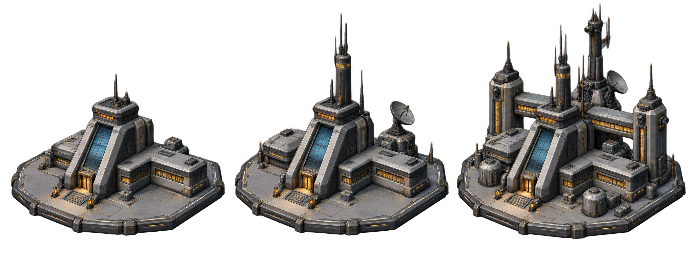

| Уровень | Что изображено |
| --- | --- |
| I | Командный корпус с наклонным остеклением, входом и небольшими боковыми блоками. |
| II | На прежнем корпусе выросла башня связи; сзади добавлены антенна и служебный блок. |
| III | Добавлены две боковые башни, задняя галерея и инженерные модули; исходный вход сохранён. |

Замечания перед игровым экспортом:

- Местами заметна цветная кайма по прозрачному контуру.

PNG 2046×768; RGBA. [Открыть оригинал](standard/headquarters.png).

### Центр снабжения

Здание действующего каталога. `supply_center`.

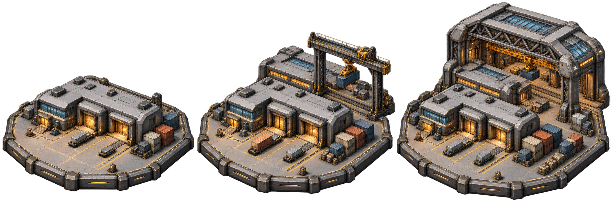

| Уровень | Что изображено |
| --- | --- |
| I | Низкий склад с двумя грузовыми воротами, диспетчерской и площадкой контейнеров. |
| II | За сохранённым складом добавлены второй корпус и портальный кран над грузовой площадкой. |
| III | Добавлен высокий крытый перегрузочный зал с фермами и мостовым краном; исходные ворота остаются доступны. |

Замечания перед игровым экспортом:

- Концепт-триптих: уровни требуют отдельного экспорта и выравнивания.
- У верхней кромки третьего уровня минимальный отступ; перед production-экспортом увеличить поле.
- По отдельным краям заметны цветные остаточные пиксели; проверить альфа-край при подготовке спрайтов.

PNG 2172×724; RGBA. [Открыть оригинал](standard/supply_center.png).

### Инженерный комплекс

Здание действующего каталога. `engineering_complex`.

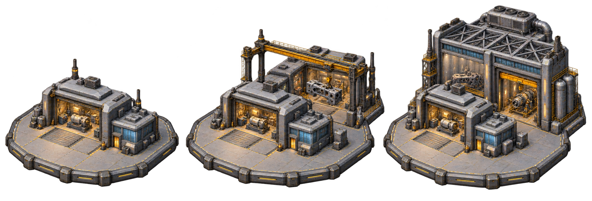

| Уровень | Что изображено |
| --- | --- |
| I | Мастерская с открытым станочным пролётом, служебной дверью и остеклённым постом управления. |
| II | К исходной мастерской добавлены второй производственный пролёт и опорный портальный кран для крупных деталей. |
| III | Добавлен высокий сборочный цех с фермами, мостовым краном и крышной системой охлаждения; исходная мастерская сохранена. |

Замечания перед игровым экспортом:

- Концепт-триптих: уровни требуют отдельного экспорта и выравнивания.
- По тонким краям местами видны цветные остаточные пиксели; перед использованием в игре очистить альфа-край.
- На третьем уровне кран среднего этапа заменён внутренним краном сборочного цеха; базовая мастерская сохраняется.

PNG 2148×732; RGBA. [Открыть оригинал](standard/engineering_complex.png).

### Космоверфь

Будущий концепт; отсутствует в каталоге. `shipyard`.

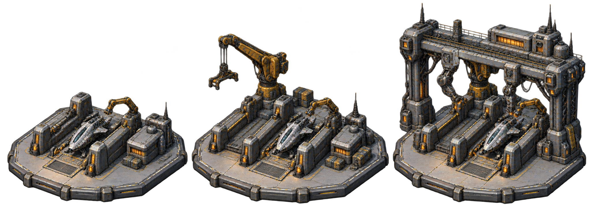

| Уровень | Что изображено |
| --- | --- |
| I | Один стапель с кораблём, небольшим манипулятором и служебным зданием. |
| II | Добавлены второй стапель, тяжёлый кран и площадки деталей. |
| III | Над стапелями установлен портальный комплекс с манипуляторами и сервисной галереей. |

Замечания перед игровым экспортом:

- Вокруг объектов есть светлый ореол; перед игровым экспортом нужна очистка альфа-канала.

PNG 2048×768; RGBA. [Открыть оригинал](standard/shipyard.png).

### Научный центр

Будущий концепт; отсутствует в каталоге. `research_center`.

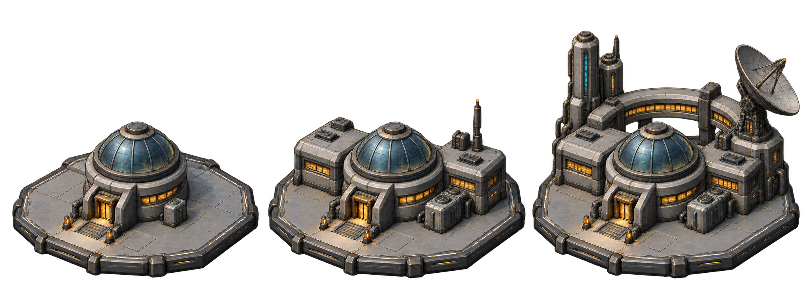

| Уровень | Что изображено |
| --- | --- |
| I | Круглый лабораторный корпус со стеклянным куполом и техническим модулем. |
| II | Добавлены боковые лаборатории, антенна и блок охлаждения. |
| III | Сзади появились полукольцевая галерея, радиотелескоп и вычислительные башни. |

Замечания перед игровым экспортом:

- Три стадии не предназначены для попиксельного наложения без выравнивания.

PNG 2046×768; RGBA. [Открыть оригинал](standard/research_center.png).

## Советский футуризм

`soviet-retrofuturism` · Soviet futurism

### Штаб корпорации

Здание действующего каталога. `headquarters`.

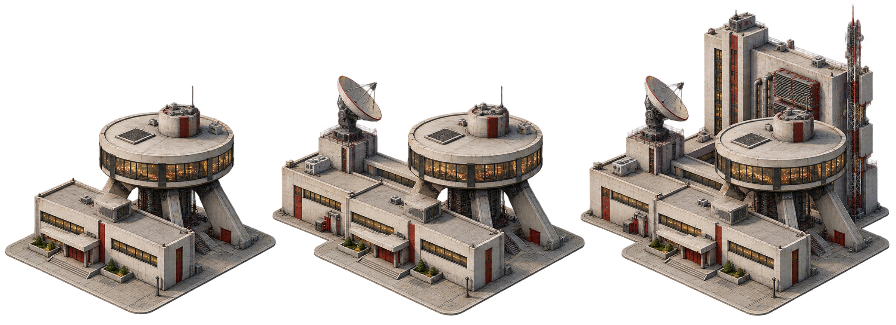

| Уровень | Что изображено |
| --- | --- |
| I | Низкий административный корпус и круглая диспетчерская на наклонных опорах. |
| II | Добавлены левое служебное крыло, закрытый переход и спутниковая антенна. |
| III | Сзади вырос координационный блок с охлаждением и мачтой связи. |

Замечания перед игровым экспортом:

- На прозрачном крае местами заметны красные и жёлтые пиксели; нужна очистка перед интеграцией.

PNG 2079×756; RGBA. [Открыть оригинал](soviet-retrofuturism/headquarters.png).

### Центр снабжения

Здание действующего каталога. `supply_center`.

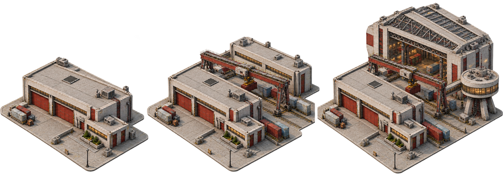

| Уровень | Что изображено |
| --- | --- |
| I | Низкий склад с двумя погрузочными воротами, контейнерами и диспетчерской пристройкой. |
| II | Добавлены второй склад и козловой кран над грузовым двором. |
| III | Добавлены высокий сортировочный ангар с фермами перекрытия и круглая диспетчерская на опорах. |

Замечания перед игровым экспортом:

- По краям присутствуют цветные пиксели ореола; перед игровым экспортом нужна очистка alpha.
- Края площадок близки к границам кадра; требуется единая безопасная область при экспорте.

PNG 2079×756; RGBA. [Открыть оригинал](soviet-retrofuturism/supply_center.png).

### Инженерный комплекс

Здание действующего каталога. `engineering_complex`.

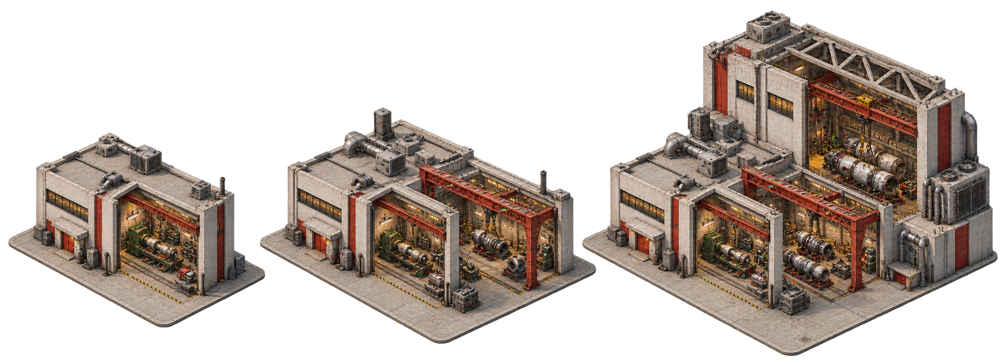

| Уровень | Что изображено |
| --- | --- |
| I | Машинная мастерская с открытым рабочим пролётом и оборудованием для обработки деталей. |
| II | Добавлены второй рабочий пролёт и красный мостовой кран. |
| III | Добавлены высокий сборочный корпус с фермами крыши, тяжёлый кран и блок охлаждения. |

Замечания перед игровым экспортом:

- По краям заметны цветные пиксели ореола; нужна очистка alpha перед игровым экспортом.
- Стадии сохраняют исходную мастерскую, но не являются выровненными слоями анимации.

PNG 2079×756; RGBA. [Открыть оригинал](soviet-retrofuturism/engineering_complex.png).

### Космоверфь

Будущий концепт; отсутствует в каталоге. `shipyard`.

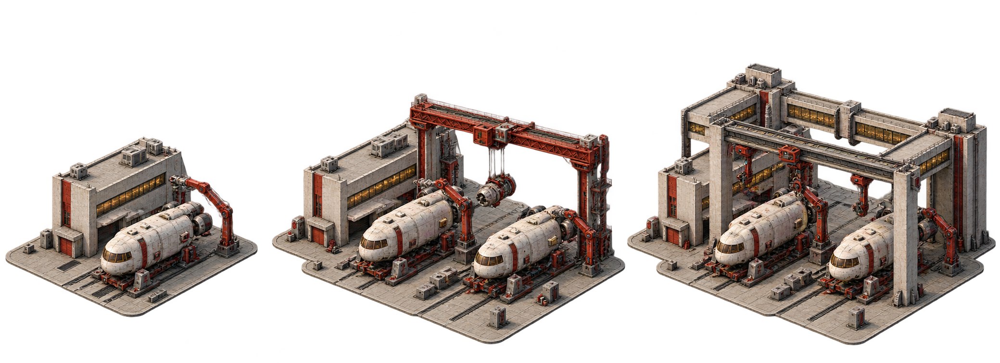

| Уровень | Что изображено |
| --- | --- |
| I | Один стапель с гражданским грузовым аппаратом, ремонтная мастерская и сервисный манипулятор. |
| II | Добавлены второй стапель и кран для перемещения двигателей и узлов. |
| III | Добавлены общий сборочный портал, подвесные манипуляторы и задняя крытая галерея. |

Замечания перед игровым экспортом:

- Цветные пиксели ореола заметны по контуру; нужна очистка alpha перед игровым экспортом.
- На третьем уровне форма подъёмного портала меняется; триптих показывает концепт, а не готовые совмещаемые слои.

PNG 2079×756; RGBA. [Открыть оригинал](soviet-retrofuturism/shipyard.png).

### Научный центр

Будущий концепт; отсутствует в каталоге. `research_center`.

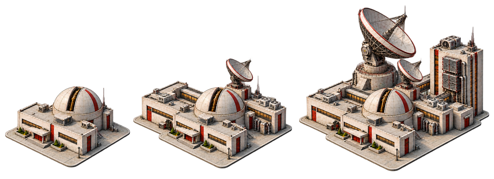

| Уровень | Что изображено |
| --- | --- |
| I | Низкая лаборатория с куполом обсерватории и открывающейся щелью для инструмента. |
| II | Добавлены боковые лабораторные корпуса, малая антенна и техническая пристройка. |
| III | Добавлены крупный радиотелескоп на массивном основании и вычислительный корпус с охлаждением. |

Замечания перед игровым экспортом:

- Цветные пиксели по контуру требуют очистки alpha перед игровым экспортом.
- Малая антенна и боковые элементы смещаются между стадиями; для анимации нужно отдельное выравнивание.

PNG 2079×756; RGBA. [Открыть оригинал](soviet-retrofuturism/research_center.png).

## Имперская космическая архитектура

`imperial` · Imperial space architecture

### Штаб корпорации

Здание действующего каталога. `headquarters`.

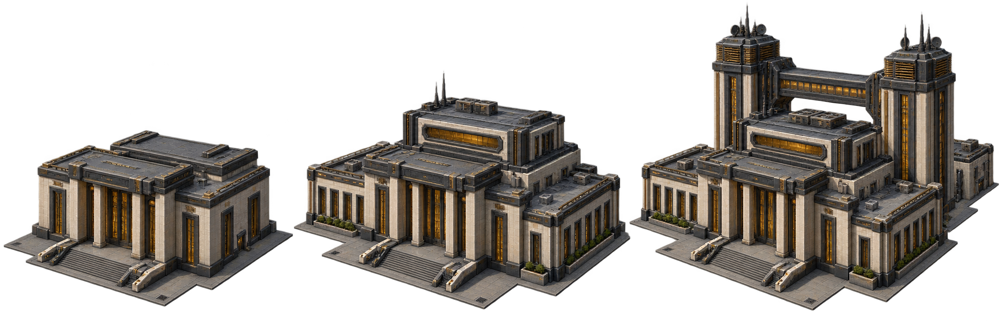

| Уровень | Что изображено |
| --- | --- |
| I | Компактный штаб с монументальным порталом и ступенчатой плоской кровлей. |
| II | Добавлены боковые административные крылья и верхний командный зал. |
| III | Сзади построены две башни связи с закрытым переходом; передний корпус сохранён. |

Замечания перед игровым экспортом:

- Местами видна цветная кайма по прозрачному контуру.

PNG 2172×724; RGBA. [Открыть оригинал](imperial/headquarters.png).

### Центр снабжения

Здание действующего каталога. `supply_center`.

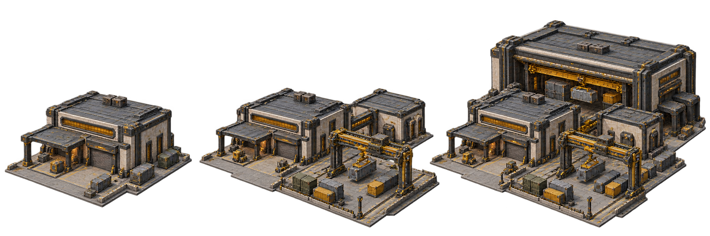

| Уровень | Что изображено |
| --- | --- |
| I | Склад с двумя погрузочными воротами, крытым навесом и контейнерами. |
| II | Добавлены боковой склад и открытый крановый двор. |
| III | Добавлен высокий перевалочный зал с мостовым краном; ранние складские корпуса сохранены. |

Замечания перед игровым экспортом:

- Ракурс и основные корпуса сохраняются; точное пиксельное совмещение стадий не гарантировано.
- По краям отдельных металлических деталей видна цветная кайма альфа-канала.

PNG 2172×724; RGBA. [Открыть оригинал](imperial/supply_center.png).

### Инженерный комплекс

Здание действующего каталога. `engineering_complex`.

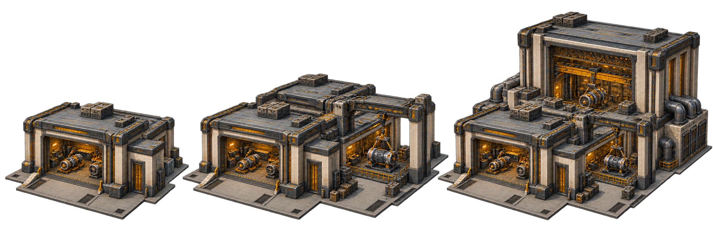

| Уровень | Что изображено |
| --- | --- |
| I | Машинный цех с открытым ремонтным боксом и вентиляцией. |
| II | Добавлены второй цех и площадка сборки под портальным краном. |
| III | Добавлен высокий сборочный зал с мостовым краном и наружным охлаждением. |

Замечания перед игровым экспортом:

- Основные ранние корпуса сохранены, но стадии требуют выравнивания для послойной анимации.
- По некоторым контурам заметна цветная кайма альфа-канала.

PNG 2172×724; RGBA. [Открыть оригинал](imperial/engineering_complex.png).

### Космоверфь

Будущий концепт; отсутствует в каталоге. `shipyard`.

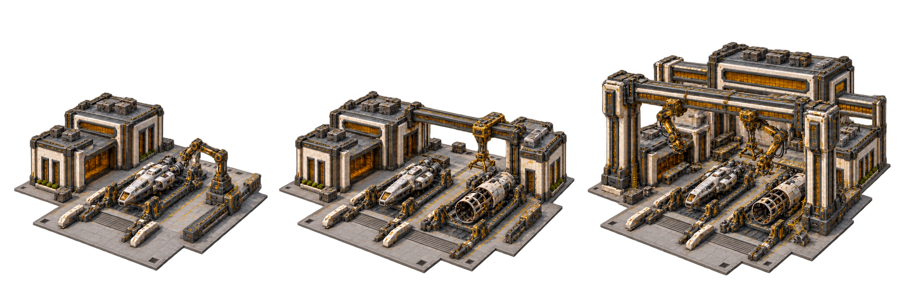

| Уровень | Что изображено |
| --- | --- |
| I | Один стапель с малым кораблём, ремонтным корпусом и монтажным манипулятором. |
| II | Добавлены второй стапель с собираемым корпусом и подъёмный кран. |
| III | Над двумя стапелями установлен сборочный портал с манипуляторами; добавлен задний производственный корпус. |

Замечания перед игровым экспортом:

- Один проход коррекции кадрирования восстановил крайние цоколи; все три стадии видны целиком.
- По отдельным контурам остаётся заметная цветная альфа-кайма.
- Стадии не подготовлены для пиксельно точной послойной анимации.

PNG 2168×725; RGBA. [Открыть оригинал](imperial/shipyard.png).

### Научный центр

Будущий концепт; отсутствует в каталоге. `research_center`.

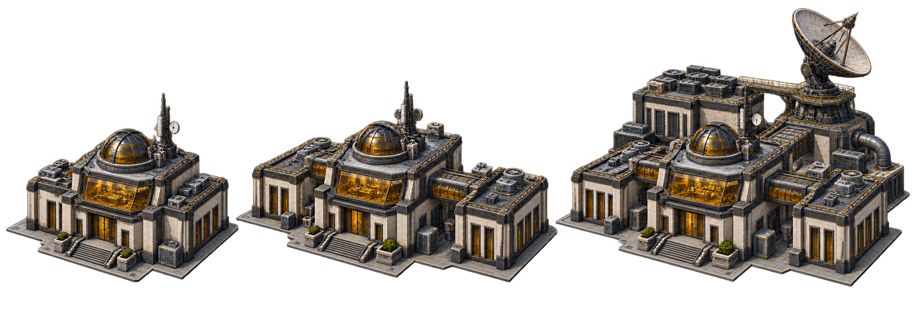

| Уровень | Что изображено |
| --- | --- |
| I | Лабораторное ядро с приборным куполом, обзорным залом и техническими блоками. |
| II | Добавлены боковые лабораторные крылья с закрытыми переходами и вентиляцией. |
| III | Добавлены задний вычислительный корпус с охлаждением и радиотелескоп на сервисной платформе. |

Замечания перед игровым экспортом:

- Раннее лабораторное ядро сохраняется; точное пиксельное совмещение стадий не выполнено.
- На отдельных контурах приборов и цоколей заметна цветная альфа-кайма.

PNG 2149×732; RGBA. [Открыть оригинал](imperial/research_center.png).

## Хайтек

`high-tech` · High-tech

### Штаб корпорации

Здание действующего каталога. `headquarters`.

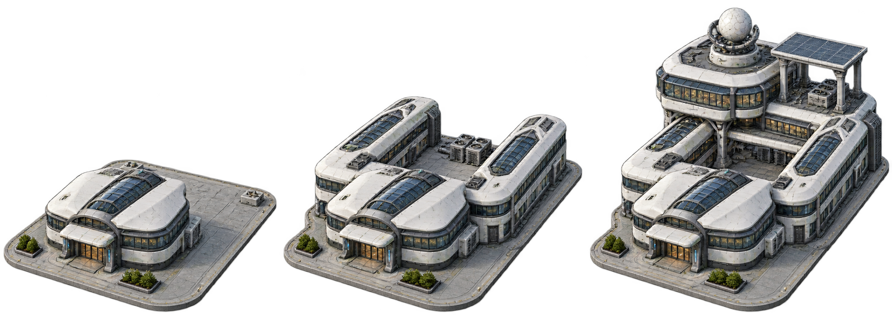

| Уровень | Что изображено |
| --- | --- |
| I | Округлый белый корпус со стеклянной кровлей и открытым подъездом. |
| II | Добавлены два продольных крыла и оборудование во внутреннем дворе. |
| III | Над задней частью появился павильон на опорах с радиопрозрачным куполом и солнечным навесом. |

Замечания перед игровым экспортом:

- Вокруг зданий есть широкий светлый ореол; потребуется очистка альфа-канала.

PNG 2048×768; RGBA. [Открыть оригинал](high-tech/headquarters.png).

### Центр снабжения

Здание действующего каталога. `supply_center`.

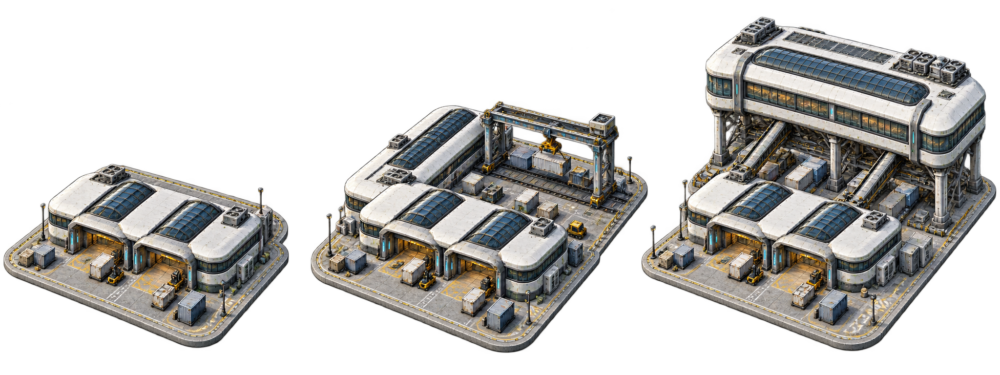

| Уровень | Что изображено |
| --- | --- |
| I | Склад с двумя погрузочными воротами, контейнерами и грузовой площадкой. |
| II | К основному складу добавлены боковой склад и рельсовый козловой кран. |
| III | Над задним участком возведён сортировочный корпус на опорах, соединённый с площадкой наклонными транспортёрами. |

Замечания перед игровым экспортом:

- Три концептуальных стадии: исходный передний объём сохранён; элементы требуют точного выравнивания перед нарезкой в игровые спрайты.
- Вокруг объектов заметна мягкая светлая кайма; требуется проверка альфа-края на игровом фоне.

PNG 2048×768; RGBA. [Открыть оригинал](high-tech/supply_center.png).

### Инженерный комплекс

Здание действующего каталога. `engineering_complex`.

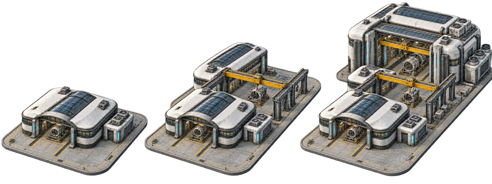

| Уровень | Что изображено |
| --- | --- |
| I | Мастерская с открытым сборочным пролётом, направляющими и боковым блоком охлаждения. |
| II | За мастерской добавлены второй цех и площадка с мостовым краном. |
| III | Появился высокий задний сборочный зал с крупным краном и дополнительным охлаждением. |

Замечания перед игровым экспортом:

- Основной передний цех узнаваем на всех стадиях; это концептуальные листы, а не точно совмещённые спрайты.
- Мягкая светлая кайма требует очистки для тёмного игрового фона.

PNG 2048×768; RGBA. [Открыть оригинал](high-tech/engineering_complex.png).

### Космоверфь

Будущий концепт; отсутствует в каталоге. `shipyard`.

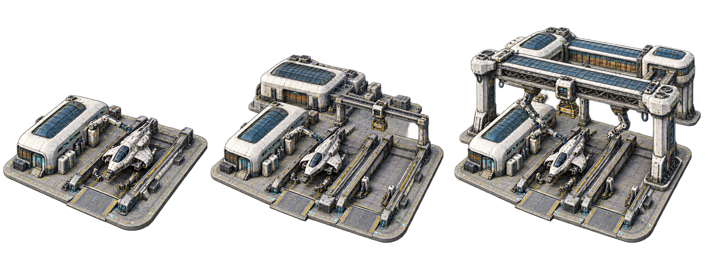

| Уровень | Что изображено |
| --- | --- |
| I | Один стапель с кораблём, сервисным корпусом и манипулятором. |
| II | Добавлены второй стапель, задний корпус снабжения и козловой кран. |
| III | Над стапелями установлены крупный сборочный портал, подвесные механизмы и сервисная галерея. |

Замечания перед игровым экспортом:

- Стапель и боковой сервисный корпус сохраняются по стадиям; механизмы ориентированы на обслуживание корабля.
- Светлая кайма требует очистки; точная нарезка и совмещение игровых спрайтов не выполнены.

PNG 2048×768; RGBA. [Открыть оригинал](high-tech/shipyard.png).

### Научный центр

Будущий концепт; отсутствует в каталоге. `research_center`.

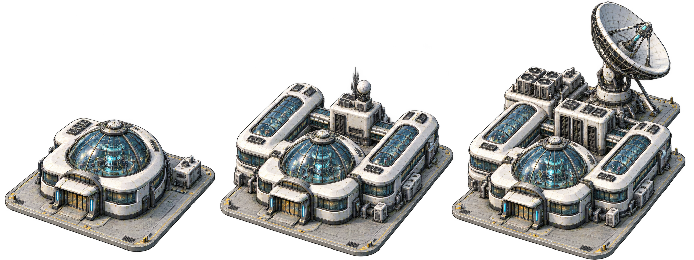

| Уровень | Что изображено |
| --- | --- |
| I | Низкий лабораторный корпус со стеклянным куполом и отдельным техническим модулем. |
| II | Добавлены два боковых лабораторных крыла, переходы и задний приборный блок с антенной. |
| III | За лабораториями установлены вычислительный блок с охлаждением и радиотелескоп на усиленном основании. |

Замечания перед игровым экспортом:

- Купольная лаборатория остаётся узнаваемой во всех стадиях; телескоп расположен на отдельной задней платформе.
- Радиотелескоп почти достигает верхней границы листа; при нарезке нужен запас.
- Светлая кайма требует очистки; стадии не выровнены попиксельно.

PNG 2048×768; RGBA. [Открыть оригинал](high-tech/research_center.png).

## Имперская готика

`imperial-gothic` · Imperial Gothic

### Штаб корпорации

Здание действующего каталога. `headquarters`.

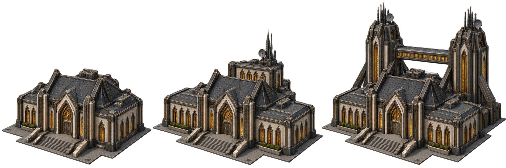

| Уровень | Что изображено |
| --- | --- |
| I | Штаб со стрельчатым входом, рёбрами фасада и высокой складчатой кровлей. |
| II | Добавлены боковые крылья и задний блок связи с антенной. |
| III | Появились две высокие башни с контрфорсами и закрытым переходом; исходный корпус остаётся узнаваемым. |

Замечания перед игровым экспортом:

- Тонкие шпили и рёбра требуют проверки после уменьшения до размера игрового участка.

PNG 2172×724; RGBA. [Открыть оригинал](imperial-gothic/headquarters.png).

### Центр снабжения

Здание действующего каталога. `supply_center`.

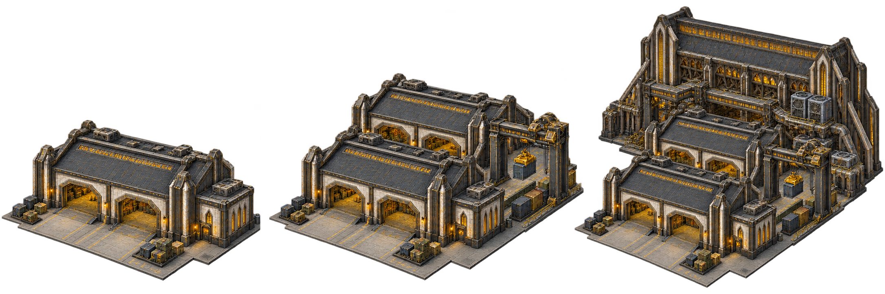

| Уровень | Что изображено |
| --- | --- |
| I | Склад с двумя погрузочными воротами, свободной площадкой разгрузки и боковым диспетчерским блоком. |
| II | Добавлены второй склад, контейнерная полоса и портальный грузовой кран. |
| III | Добавлены высокий крытый сортировочный зал, верхняя перегрузочная галерея и блоки охлаждения. |

Замечания перед игровым экспортом:

- Три стадии читаются слева направо; передний склад сохранён. Широкие ворота доступны с площадки.
- Контур содержит мелкие цветные полупрозрачные пиксели; перед игровым экспортом требуется проверка альфа-края и единое выравнивание.

PNG 2172×724; RGBA. [Открыть оригинал](imperial-gothic/supply_center.png).

### Инженерный комплекс

Здание действующего каталога. `engineering_complex`.

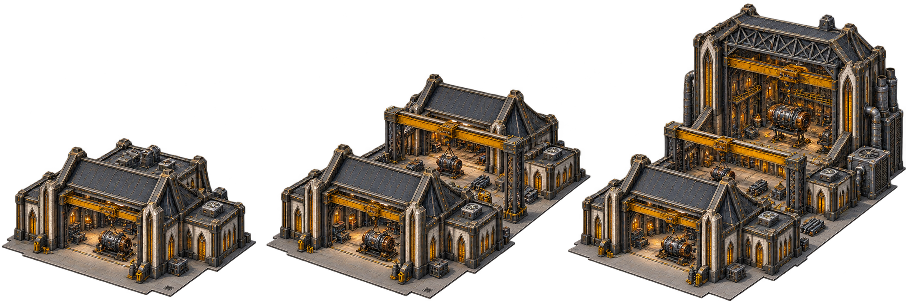

| Уровень | Что изображено |
| --- | --- |
| I | Мастерская с широким сборочным проёмом, кран-балкой и боковым служебным блоком. |
| II | Добавлены второй производственный корпус, общая площадка и мостовой кран над крупными узлами. |
| III | Добавлены высокий сборочный зал с фермами и мощным мостовым краном, вытяжные трубы и охлаждение. |

Замечания перед игровым экспортом:

- Производственная функция читается по открытым цехам, подъёмным кранам и деталям машин. Нижний цех сохраняется при развитии.
- Концептные стадии не выровнены попиксельно; при экспорте отдельных спрайтов потребуется проверка краёв и якорей.

PNG 2172×724; RGBA. [Открыть оригинал](imperial-gothic/engineering_complex.png).

### Космоверфь

Будущий концепт; отсутствует в каталоге. `shipyard`.

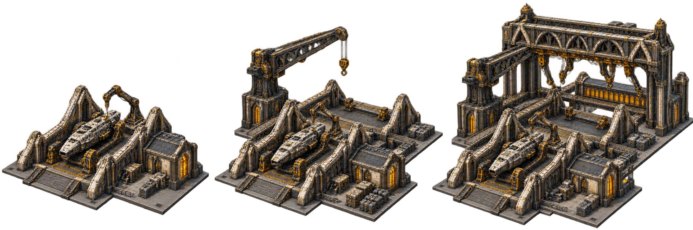

| Уровень | Что изображено |
| --- | --- |
| I | Один корабль на стапеле, сервисный манипулятор и боковая ремонтная мастерская. |
| II | Добавлены второй стапель, поворотный грузовой кран и склад деталей. |
| III | Добавлены большой сборочный портал с подвесными механизмами и задняя служебная галерея. |

Замечания перед игровым экспортом:

- Вокруг части контуров заметны цветные артефакты альфа-края; требуется очистка перед использованием спрайтов.
- Готические фермы и контрфорсы несут элементы дока. Корабль и базовая мастерская сохранены во всех стадиях.

PNG 2172×724; RGBA. [Открыть оригинал](imperial-gothic/shipyard.png).

### Научный центр

Будущий концепт; отсутствует в каталоге. `research_center`.

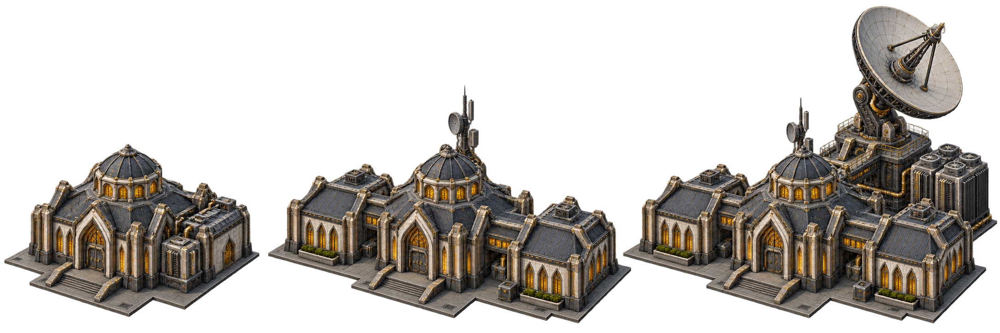

| Уровень | Что изображено |
| --- | --- |
| I | Центральная лаборатория с небольшим приборным куполом и боковым блоком инженерных систем. |
| II | Добавлены два лабораторных крыла, соединительные переходы и антенна на крыше. |
| III | Добавлены наблюдательная платформа с радиотелескопом и вычислительный блок с охлаждением. |

Замечания перед игровым экспортом:

- Три стадии сохраняют лабораторное ядро; радиотелескоп стоит на отдельной опоре.
- Доступ в передний корпус выполнен по лестнице. Мелкие цветные пиксели альфа-края и взаимное выравнивание нужно проверить перед игровым экспортом.

PNG 2172×724; RGBA. [Открыть оригинал](imperial-gothic/research_center.png).
