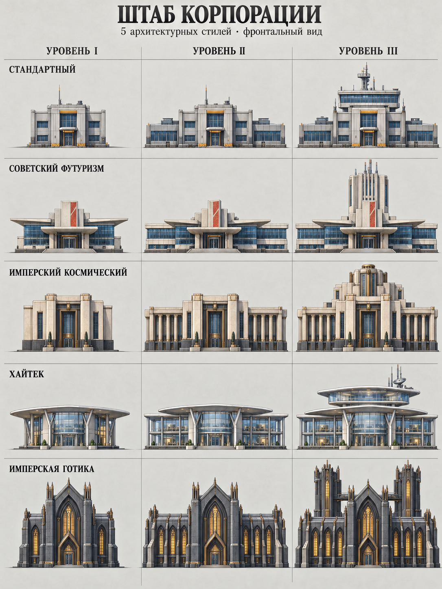
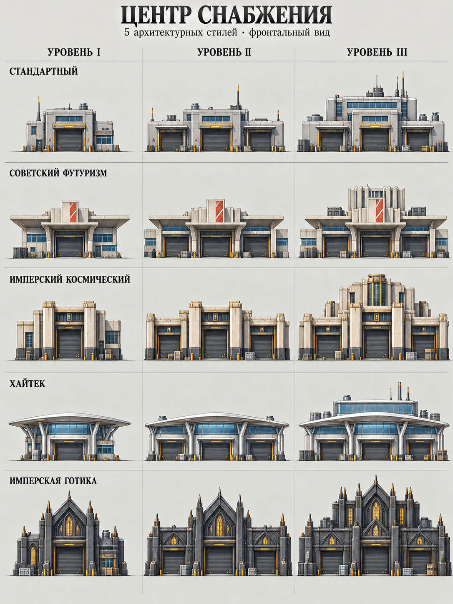
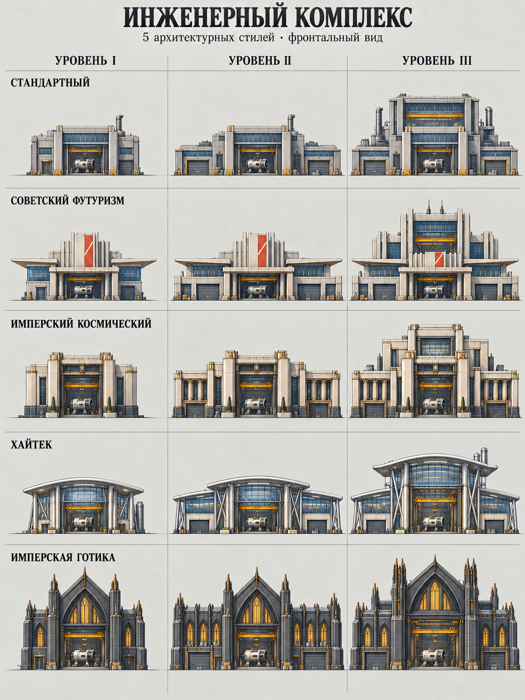
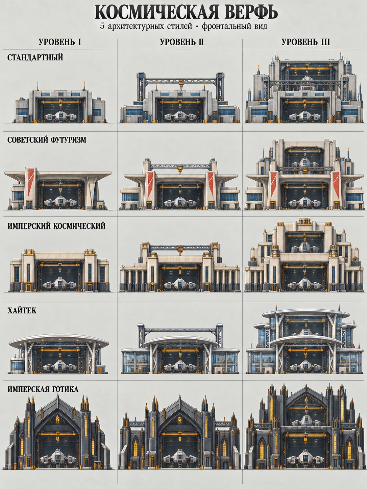
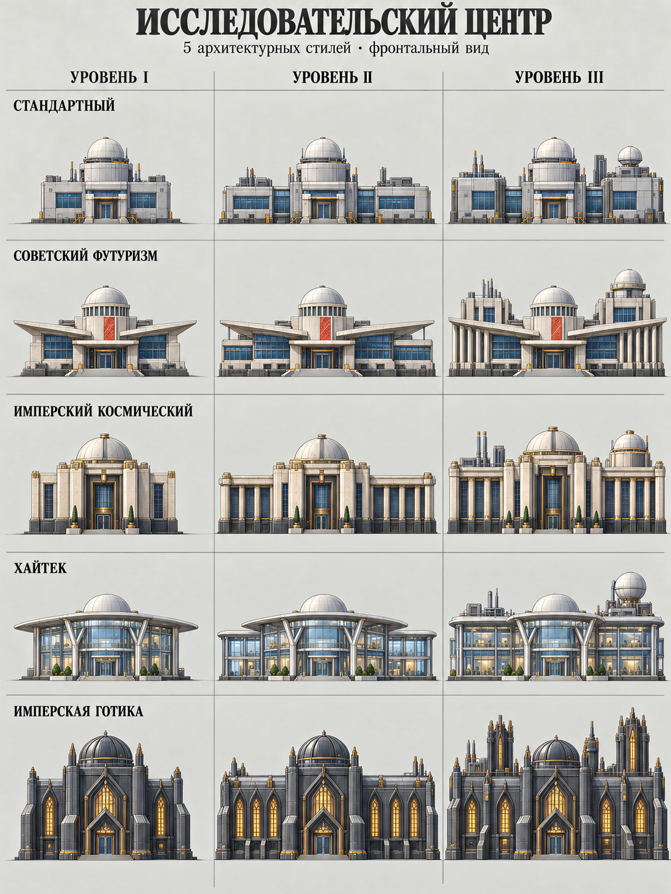

# Здания корпорации — фронтальные концепты

Новая художественная подача, согласованная 28.10.2026: **пять построек, пять
самостоятельных стилей, три уровня**. Пять PNG содержат 75 изображённых стадий.
Это сравнительные концепт-листы с подписями, а не 75 готовых игровых спрайтов.

[Правила архитектуры и состояние подключения](../../../docs/corporation-building-art.md) ·
[Манифест файлов](manifest.json) · [Предыдущая галерея](../README.md)

На каждом листе столбцы слева направо — **I → II → III**. Порядок строк одинаков:

| Строка | Стиль | ID | Основные признаки |
| --- | --- | --- | --- |
| 1 | Стандартный | `standard` | Практичные прямоугольные корпуса, бетон и металлические панели, небольшие служебные акценты |
| 2 | Советский футуризм | `soviet-retrofuturism` | Светлый бетон, выразительные козырьки, ленточное остекление, рёбра и красная керамическая вставка |
| 3 | Имперский космический | `imperial` | Монументальные пилоны, глубокие проёмы, ступенчатые объёмы, светлый камень и бронза |
| 4 | Хайтек | `high-tech` | Тонкий металлический каркас, стекло, лёгкие оболочки и ясные соединения модулей |
| 5 | Имперская готика | `imperial-gothic` | Тёмный камень и металл, стрельчатые формы, контрфорсы и вертикальные акценты |

Имперский космический и имперская готика остаются двумя отдельными стилями.
Стиль меняет внешний вид, а назначение здания определяет его проёмы, оборудование
и объёмы. Изображённые устройства не задают новых игровых эффектов.

## Штаб корпорации

`headquarters` — здание действующего каталога.

| Уровень | Что изображено |
| --- | --- |
| I | Основной административный корпус с узнаваемым входом и рабочими помещениями |
| II | Дополнительные боковые крылья вокруг прежнего корпуса |
| III | Верхний командный объём или башни; у готического варианта две боковые башни, у хайтека верхний застеклённый блок |

## Центр снабжения

`supply_center` — здание действующего каталога.

| Уровень | Что изображено |
| --- | --- |
| I | Складское ядро с широкими грузовыми воротами, служебным входом и контейнерами |
| II | Дополнительные боковые погрузочные секции с отдельными воротами |
| III | Увеличенный складской объём и верхние служебные помещения; основные грузовые проезды остаются открытыми для доступа |

## Инженерный комплекс

`engineering_complex` — здание действующего каталога.

| Уровень | Что изображено |
| --- | --- |
| I | Мастерская с открытым сборочным проёмом, узлом на сборке и подвесным грузоподъёмным механизмом |
| II | Боковые цеха и дополнительные производственные входы |
| III | Высокий сборочный зал с мостовым краном и дополнительным остеклением; инженерные системы связаны с рабочими объёмами |

## Космическая верфь

`shipyard` — визуальный концепт будущей постройки; не добавляет корпоративную верфь
в игровой каталог. Подпись на листе — «КОСМИЧЕСКАЯ ВЕРФЬ».

| Уровень | Что изображено |
| --- | --- |
| I | Открытый сборочный док с кораблём на стапеле и обслуживающими помещениями |
| II | Боковые мастерские, дополнительные опоры и грузоподъёмная конструкция |
| III | Второй сборочный объём выше и позади исходного дока, расширенные служебные крылья и крановое оборудование |

## Исследовательский центр

`research_center` — визуальный концепт будущей постройки; в предыдущей галерее
назван «Научный центр». Механика корпоративных исследований этим пакетом не вводится.

| Уровень | Что изображено |
| --- | --- |
| I | Лабораторное ядро с приборным куполом и рабочими помещениями |
| II | Боковые лабораторные крылья при сохранении центрального корпуса и купола |
| III | Более высокие экспериментальные блоки, дополнительные приборные и технические объёмы по краям комплекса |

## Общие требования к следующей отрисовке и экспорту

- Строго фронтальный вид: камера перпендикулярна главному фасаду, без разворота в три
  четверти. Одинаковые направление света и линия земли для последовательных уровней.
- Сохранять основное ядро, расположение входа и масштаб дверей. Расширение показывать
  пристройками и оборудованием, связанными с функцией здания.
- Различать стили силуэтом, конструкцией и материалами. Кран должен обслуживать рабочую
  зону, опора — нести перекрытие, ворота — иметь свободный подъезд.
- Крупные формы должны читаться в игровом размере; мелкая декоративная детализация
  не заменяет понятной конструкции.

Каждый исходник — **PNG 1086×1448, RGB, непрозрачный фон**, с названиями стилей и
уровней внутри изображения. Файлы сохранены без перерисовки, ресайза или перекодирования.
Контрольные суммы и размеры находятся в манифесте.

Для игрового экспорта нужно отделить здания от фона и подписей, выровнять масштаб и
якорь земли между стадиями, очистить края и проверить силуэт в размере участка базы.
Концепты не гарантируют попиксельного совпадения неизменных частей и не являются
готовыми слоями анимации. Старый `scripts/cut-corp-art.py` рассчитан на горизонтальные
триптихи; новые листы 5×3 нельзя подавать ему как прежний формат.

Эта поставка публикует исходные концепты и описания. Подключённые игровые WebP,
ассортимент магазина и механики построек меняются отдельной реализацией.

## Происхождение и архитектурные референсы

Изображения созданы встроенным ImageGen в этой переписке. Первым подготовлен и одобрен
лист штаба; он использован как визуальный образец для остальных четырёх листов.
Архитектурные референсы задавали конструктивный язык, пропорции и материалы:

| Направление | Референсы | Что использовано в художественном задании |
| --- | --- | --- |
| Стандартный | [NASA Vehicle Assembly Building](https://www.nasa.gov/kennedy/partnerships/vehicleassemblybuilding/) | Функциональная организация промышленных корпусов и крупных рабочих проёмов |
| Советский футуризм | [ЦНИИ РТК](https://visit-petersburg.ru/leisure/places/tp-198085-tsnii-robototekhniki-i-tekhnicheskoy-kibernetiki/), [Дворец пионеров](https://mosmuseum.ru/tours/p/dvorets-pionerov/) | Контраст горизонтальных корпусов и выразительных объёмов, бетон, стекло и козырьки |
| Имперский космический | [Les Espaces d’Abraxas, Ricardo Bofill](https://ricardobofill.com/es/projects/les-espaces-dabraxas/) | Монументальная ось, крупные пилоны, глубокие регулярные проёмы |
| Хайтек | [McLaren Technology Centre](https://cars.mclaren.com/de_de/about/our-home), [Renault Distribution Centre](https://historicengland.org.uk/listing/the-list/list-entry/1416061/) | Точная сборка, лёгкий каркас, остекление и функциональные инженерные элементы |
| Имперская готика | [Амьенский собор](https://whc.unesco.org/en/list/162/) | Вертикальный ритм, стрельчатые проёмы и логика опор |

Фотографии референсов в пакет не включены. Исходные листы предназначены для оценки
художественного направления; финальная подготовка игровых ассетов описана выше.
