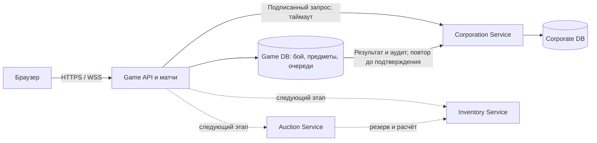

# Независимый сервис корпораций

Первый этап разделения мета-слоя: корпоративное состояние обслуживает отдельный
процесс с отдельной PostgreSQL. Игровой процесс продолжает обслуживать матчи,
аккаунты, личный инвентарь и текущий MetaMarket. Выделение аукциона и инвентаря —
следующие этапы; эта ветка их не реализует. Развёртывание на живом сервере требует
переноса данных и настройки оператора; добавление кода само по себе этого не делает.

[Архитектурная карта SVG](diagrams/corporation-services.svg) ·
[Исходник карты](diagrams/corporation-services.dot) ·
[Модель корпораций](corporations.md) · [Войны](corporation-wars.md) ·
[Общий роадмап отказоустойчивых сервисов](service-resilience-roadmap.md).

## Границы ответственности

| Владелец | Данные и операции |
| --- | --- |
| Game | Авторизация аккаунта, обычные матчи, состояние боя, места и часы AvA, закреплённый состав, личный/корпоративный инвентарь, аренда, текущий MetaMarket |
| Corporation Service | Членство и роли, влияние, строительство, готовность, вызовы и ростеры AvA, результаты, лента, медали, аудит |
| Game PostgreSQL | `matches`, `ava_sessions`, предметы и кошельки; `ava_result_delivery` и `corp_return_audit` для восстановления передачи |
| Corporate PostgreSQL | Десять корпоративных таблиц из `CORPORATE_TABLES`; служебная `corp_gateway_nonces` для защиты от повторов |

Оба сервиса пока собираются из одного репозитория и одного проверенного образа,
но запускаются разными командами и могут размещаться на разных стендах.
Общий код и образ не требуют общего процесса. Обновление схемы каждой БД выполняется
отдельно. Корпоративная БД пока получает общий набор таблиц при миграции, однако
игровые данные туда не копируются и корпоративным API не обслуживаются.

## Что происходит при отказах

| Сбой | Поведение |
| --- | --- |
| Corporation Service недоступен | Корпоративный API возвращает `503 E_CORPORATIONS_UNAVAILABLE`; Game запускается и обслуживает обычные матчи, регистрацию и `/arsenal/me` |
| Корпоративная БД недоступна | Корпоративные операции не подтверждаются; личный инвентарь читает Game DB |
| Корпорации исчезли после запуска AvA | Закреплённые места и часы боя остаются в Game; новые вызовы и изменения ростера требуют корпораций |
| Матч завершился при отказе корпораций | Возврат аренды выполняется локально; аудит и итог остаются неподтверждёнными и повторяются после восстановления |
| Game упал после сохранения окончания боя | Worker находит завершённый снимок и `ava_sessions`; отдельного успешного callback для постановки результата в очередь не требуется |
| Подтверждение результата/аудита потеряно | Повтор не начисляет влияние и не списывает прочность снова; запись аудита дедуплицируется по `event_id` |
| Game DB недоступна | Матчи и локальный инвентарь зависят от неё; этот этап их друг от друга не изолирует |
| Потерян общий VPS | Разные процессы и тома на одном хосте не защищают от потери всего хоста |

Долговечные гарантии относятся к PostgreSQL. Memory-режим остаётся средством
разработки: рестарт теряет его состояние. У `prototype/netserver.ts` доступны
корпорации и строительство, а полноценный AvA — у `packages/server/src/main.ts`.
Gateway сохраняет это различие через `/corps/me.features`.

## Целостность и доверие

Публичный запрос сначала проходит проверку JWT и актуального пароля в Game.
Корпоративный сервис получает только подписанную личность (`accountId`, `login`)
и исходный IP; `AUTH_JWT_SECRET` ему не передаётся. HMAC-SHA256 связывает запрос с
методом, путём, телом, временем и nonce. Окно времени — 30 секунд; nonce сохраняется
в корпоративной БД. Ответ подписан и связан с исходным запросом, статусом и телом.
Внутренние RPC ограничены перечнем методов; gateway не публикует `/internal/*`.
Тело ограничено 1 MiB, обычный межсервисный таймаут — 2 секунды, HTTP redirect запрещён.
`DependencyGuard` допускает до 16 активных вызовов на endpoint/процесс, без очереди;
после трёх подряд transport/signature/parse отказов или ответов 5xx открывает
circuit на 5 секунд, затем разрешает одну пробу. Подписанный бизнес-отказ 4xx, включая
пользовательский rate-limit 429, подтверждает доступность; запоздалый ответ старого поколения не меняет новый circuit.
URL проверяется до guard: изменение пути при нормализации, другой origin и fragment
отклоняются без отправки; gateway отвечает `400 E_BAD_REQUEST`. Автоматического
повтора команды нет. Остальные игровые маршруты этот guard не используют.
Ключ `CORPORATIONS_KEY` должен быть случайным, отдельным от JWT, минимум 32 символа.
Синхронизация часов на двух стендах обязательна.

Подпись обеспечивает подлинность и целостность, но не шифрует содержимое.
Compose использует HTTP внутри закрытой сети одного Docker-хоста. При размещении
на разных хостах используйте HTTPS с проверяемым сертификатом и приватную сеть;
сервис поддерживает существующие `TLS_KEY_FILE`/`TLS_CERT_FILE`. Не публикуйте его
порт или PostgreSQL в интернет. Компрометация gateway/key позволяет подписывать
корпоративные команды: это явная граница доверия, а не полная ZTA.

Проверки прав, изменения и аудит корпоративной операции разделяют одну SERIALIZABLE
транзакцию. Вложенные транзакции стора становятся savepoint. Повторяются только
явные serialization/deadlock abort, максимум три попытки; неопределённый сетевой
исход не считается разрешением повторно списать деньги.

При возврате аренды локальная транзакция закрывает аренду, меняет прочность и
создаёт запись для доставки аудита. Подтверждение аудита происходит позже.
Результат AvA подтверждается только после возврата, корпоративного результата
и доставки аудита. Worker проходит до 100 записей за цикл, откладывает неудачи
минимум на 5 секунд и не оставляет плохую запись постоянно первой; цикл — 60 секунд.
Между БД нет распределённой транзакции. Создание аренды ещё использует раздельные
проверки корпоративных прав и локальную запись — строгую атомарность этих действий
нужно добавить при выделении Inventory через явный контракт разрешения/резерва.

## Запуск и перенос существующих данных

Без `CORPORATIONS_URL` сохраняется интегрированный режим. С переменной оба игровых
входа используют корпоративный gateway; Game не зависит от готовности Corp при старте.

Для отдельного локального стека задайте `CORPORATIONS_KEY` и
`CORP_POSTGRES_PASSWORD` в защищённом env-файле и примените
`deploy/docker-compose.corporations.yml` поверх базы. Корпоративный процесс запускает
`packages/server/dist/corporation-server.mjs`, порт по умолчанию 8789; `/health` —
liveness, `/ready` проверяет БД. PostgreSQL и API не имеют опубликованных портов.

Для релиза добавьте `deploy/docker-compose.corporations-release.yml` после остальных
оверлеев и используйте `--no-build`: оба процесса используют один `VOID_IMAGE`,
предварительно проверенный `deploy/verify-image.sh`. Этот оверлей требует
`CORP_RUNTIME_USER`/`CORP_RUNTIME_PASSWORD`, отключает автоматический DDL и включает
проверку минимальных прав. Подготовка ролей выполняется по
[runbook разделения ролей](security/zero-trust-rollout.md) отдельно для корпоративной БД.
Её runtime-роль не должна иметь доступ к Game DB; административные credentials не
передаются сервису. Обе БД нуждаются в собственных зашифрованных бэкапах и учении restore.

Перенос выполняется оператором, до открытия нового корпоративного сервиса:

1. Сохранить и проверить бэкапы; обновить схему Game DB, включая новые очереди.
2. Включить `CORPORATIONS_MAINTENANCE=1` на **всех** игровых входах и перезапустить их.
   Корпоративные API и корпоративные sweeps остановлены; обычные матчи продолжаются.
   Старые процессы/служебные писатели также остановить. Новый Corp ещё не запускать.
3. Создать отдельную пустую целевую БД. Передать мигратору в защищённом env-файле
   `CORPORATIONS_SOURCE_URL` и `CORPORATIONS_DATABASE_URL`; источник — read-only
   доступ к корпоративным таблицам, цель — доступ для миграции.
4. Запустить `node packages/server/dist/corporation-migrate.mjs` для dry run.
   Вывод содержит только количества, не credentials или данные игроков.
5. Повторить с `--apply`. Мигратор отказывается перезаписывать непустые корпоративные
   таблицы, копирует десять таблиц одной транзакцией, сохраняет ID и последовательность
   аудита. Игровые матчи, места, предметы и аренду не копирует; источник не удаляет.
6. Подготовить минимальные runtime-права/ревизию схемы в целевой БД. Запустить Corp,
   проверить `/ready`, права и количество записей; настроить Game URL/key, убрать
   maintenance и перезапустить игровые процессы. Проверить доставку ожидающих итогов.

Переменная maintenance сама по себе не блокирует обходные подключения к БД:
заморозка всех писателей — обязанность оператора. Для отката до открытия новых
записей можно вернуть Game в интегрированный режим и прежнюю БД. После новых
корпоративных записей простой откат URL потеряет их: требуется согласованный обратный
перенос, а не переключение на старую копию. Не очищать старые таблицы до завершения
проверенного cutover.

## Проверки и пределы проверенного

Автоматические тесты покрывают подпись/подмену/повторы, replay после перезапуска,
откат списания при сбое аудита, откат наград при сбое settlement, повтор доставки,
возврат аренды при недоступном аудите, восстановление из снимка и перенос данных.
`pnpm run smoke:corporation-service` запускает два реальных процесса с двумя
локальными `*_test` БД: cold boot без Corp, остановка/перезапуск Corp, доступность
матчей/регистрации/инвентаря и запрет смены роли постороннему. Нужны
`GAME_TEST_DATABASE_URL` и `CORPORATIONS_TEST_DATABASE_URL`.

Отдельно проверен runtime-бандл в nonroot distroless-контейнере с read-only rootfs,
без Linux capabilities. Это проверка нового entrypoint на существующем runtime;
полную сборку и проверку опубликованного образа выполняет CI. Не проверены живой
сервер, межхостовой TLS/VPN, реальные backups нового стенда и пользовательский
полный бой AvA на удалённой инфраструктуре.

Порядок, критерии и контракт следующего этапа — в
[общем роадмапе](service-resilience-roadmap.md). Inventory владеет предметами, резервами и экономическим ledger;
Auction владеет книгой лотов и запрашивает резерв/расчёт, но не меняет предметы напрямую.
Корпоративное влияние остаётся в Corp и не превращается в торгуемую валюту.
Личный инвентарь должен работать без Auction и Corp. Для этого нужны отдельные БД,
идемпотентные команды, явные права аренды, reconciliation и проверка отказов каждого
сервиса; пунктирные блоки карты отражают этот целевой контракт.
