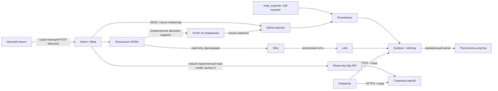

# Пульт плейтестов MoonGame — план наблюдаемости

Заказ владельца: 2026-10-16. Нужен сайт, на котором видны состояние сервера,
партии, связь, ошибки и поведение тестеров. **Это план, а не описание работающего
стенда.** Источники и границы первого выпуска зафиксированы в
[контракте OBS-0.1](observability-contract-v1.md); там же выбран профиль хранения,
доступа и уведомлений. [Пассивный on-host baseline](reviews/2026-10-16-obs-0-1-baseline.md)
не заменяет нагрузочную/24-часовую приёмку будущего мониторинга.

Начальная площадка: Ubuntu 26.04, 4 CPU, 6 GB RAM, 60 GB NVMe. Домен и внешний
получатель внешних уведомлений пока не выбраны: первый профиль — SSH-only и алерты
только в закрытом пульте (решение владельца 2026-10-16). Пароли, IP конкретного хоста и другие
секреты в репозиторий не включаются. Цель первого выпуска — видеть плейтест
через готовую Grafana, затем добавить небольшую страницу состояния партий.

## 1. Решение и границы

- **Grafana OSS** — единый сайт, дашборды и Grafana-managed alerting.
- **Prometheus** — числовые временные ряды; pull по внутренней сети.
- **Loki, single-binary** — поиск по разрешённым техническим логам.
- **Grafana Alloy** — чтение разрешённых файлов, фильтрация и доставка в Loki.
  Новый Promtail не вводим.
- **node_exporter** — метрики хоста; ограниченный Game exporter преобразует
  существующие JSON-метрики в Prometheus exposition. Дополнительный DB exporter
  подключается отдельным шагом с собственной мониторинговой ролью.
- **Read-only Ops API и страница матчей** — второй выпуск, только там, где
  готовые дашборды не дают нужного представления. Без рестартов, банов, SQL,
  изменения мира и финансовых выдач из этого пульта.

Sentry/GlitchTip, PostHog, ClickHouse, OTel-трейсинг, отдельный Alertmanager и
Kubernetes не входят в минимальный выпуск. Их внедрение требует измеренного
пробела, бюджета и отдельного решения. Ошибки браузера сначала показываются по
существующему `client_error`; полноценная группировка стеков — отдельный этап.
Grafana не заменяет служебные дела, модерацию или SIEM.

«Все метрики и состояния» означает согласованный набор наблюдаемых показателей.
Полные `GameState`, снимки БД, кошельки, payload команд и скрытые туманом данные
не копируются в хранилище мониторинга. Источником истины остаются игровые домены.

## 2. Опора на существующий код

| Источник | Что действительно есть | Ограничение для нового пульта |
| --- | --- | --- |
| `Dockerfile`, `CODE-MAP.md` | Production запускает `proto-server.mjs`, собранный из `prototype/netserver.ts` | Проверять этот entrypoint; `packages/server/src/main.ts` — другой хост |
| `packages/server/src/wsServer.ts` | `/health` с версией, `/ready` с readiness; операторский `/metrics` возвращает JSON `{matches,connections}` | Это не Prometheus endpoint; readiness отдельно от liveness |
| `prototype/netserver.ts` | `/metrics/summary`, `/metrics/health`, `/metrics/recent` | Агрегатор общий для процесса; per-match live API пока отсутствует |
| `packages/server/src/metrics.ts` | Действия/отказы, desync/dead letter/overflow, count/total/max/avg таймингов и размеров, FPS/RTT | Нет histogram buckets; p95 из avg/max восстановить нельзя; counters сбрасываются при рестарте |
| `packages/server/src/dailyJsonl.ts` | Bounded очередь, суточные `match-*.jsonl` и `client-*.jsonl`, written/dropped/failed | Есть ротация имени по UTC-дню; TTL и дисковая квота не реализованы |
| `prototype/netserver.ts` | Summary каждые 10 минут, `run` отделяет рестарты; частые timing/broadcast пишутся выборочно | Нельзя трактовать выборочный JSONL как полную гистограмму задержек |
| `packages/server/src/telemetryApi.ts`, `packages/protocol/src/telemetry.ts` | `POST /telemetry`: словарь, лимиты, серверный actor, счётчики приёмника | Клиентские данные недоверенные; install не равен человеку; окно activeInstalls — 5 минут |
| `prototype/analytics.mjs`, `prototype/analyticsReport.mjs`, `prototype/report.mjs` | Разбор воронки, связи, когорт и игровых журналов, дедуп клиентских событий | Сейчас CLI, а не постоянно работающая БД аналитики или веб-сервис |
| `packages/server/src/operatorAccess.ts`, `deploy/Caddyfile` | Метрики только direct loopback без forwarding или bearer; публичный Caddy блокирует `/metrics` и `/metrics/*` | Контейнерный exporter использует серверный секрет; браузеру его не передавать |
| `deploy/docker-compose.yml`, TLS overlay | Постоянные тома БД/журналов, лимиты ресурсов и Docker logs; Caddy | Нет готового observability Compose-стека, Grafana provisioning и удалённого сборщика |

`/metrics/recent` читает текущий файл целиком; постоянным сборщиком его не опрашивать.
`/metrics/health` содержит накопленные за процесс max/min и ошибки, поэтому не
заменяет оконные правила алертов. Сброс counters и период без данных показывать явно.

## 3. Потоки и доверие

Стрелка от источника к Prometheus обозначает сбор: **соединение инициирует
Prometheus**, exporter принимает scrape. Клиентам известен только существующий
Game ingress, не адреса Prometheus/Loki и не операторские ключи.

### Режимы размещения

**Первый VPS:** отдельные процессы, тома, лимиты и наблюдательная сеть Compose
на том же хосте. Grafana сначала доступна через SSH-туннель; после появления DNS
— отдельный HTTPS hostname через существующий Caddy. Node/DB/Game exporters,
Prometheus, Loki и Alloy наружу не публикуются. Отсутствие домена не оправдывает
публичную HTTP-форму с административным паролем.

Это bootstrap-режим с общей точкой отказа. При потере VPS исчезнут и игра, и
локальная история; такой режим не закрывает требования независимого аудита,
SIEM или DR из [security-operations-roadmap.md](security-operations-roadmap.md).

**Следующий шаг:** вынести Grafana/Prometheus/Loki и их диски на отдельный небольшой
хост либо согласованную внешнюю площадку. Node exporter и Alloy остаются рядом
с игрой; scrape/push идут по приватному VPN или TLS с проверкой peer и
персональными сервисными credentials. Безопасность и разрешённое размещение
данных проверяются до передачи во внешний сервис. Недоступность площадки не
входит в Game readiness и не останавливает матч.

### Доступ и секреты

- Отдельные операторские учётные записи Grafana; anonymous access и self-signup
  выключены. Viewer для наблюдения, редкие операции настройки — отдельный Admin.
  При публичном доступе — MFA через поддерживаемый auth gateway/IdP; до его
  приёмки оставляем SSH/VPN-only, не обещаем MFA в локальном OSS login.
- Обратный прокси закрывает прямой обход: доверенные auth headers принимаются
  только от gateway. Проверки включают API, datasource proxy, Explore, snapshots,
  sharing и прямые порты; публичные снимки/шаринг запрещены.
- `METRICS_TOKEN` существует только в серверном scrape-компоненте/защищённом
  secret-файле. Прокси не подставляет его в произвольные URL из браузера.
  Существующий широкий bearer — временная опора; для нового read-model нужен
  отдельный scoped credential, не Game JWT и не DB-admin.
  Exporter с этим bearer не считается изолированным от pre-fog данных: он может
  прочитать и другие операторские маршруты. До выноса exporter на внешнюю площадку
  добавить отдельный metrics-only scope/credential и отрицательные проверки
  `/metrics/recent`; один allowlist в самом exporter не ограничивает украденный ключ.
- Grafana datasource credentials read-only. Внутренняя сеть сама по себе не
  считается authentication при выносе на другой хост. Запись в Loki идёт через
  ограниченный ingress: у OSS Loki нет готовой пользовательской авторизации.
- Collector не получает игровой Docker socket, root shell и общую DB-роль.
  Для host/container health при необходимости отдельный локальный timer делает
  фиксированный allowlist `docker inspect` и отдаёт только числа через textfile;
  ни endpoint с произвольной командой, ни socket внутрь Grafana не передаются.

## 4. Контракт метрик и истории

### Метрики v1

Имена ниже — проектируемый контракт, отсутствующие поля не считаются реализованными.
Exporter должен валидировать вход и отдавать только allowlist, с timeout 2 с,
scrape каждые 15 с, без параллельных одинаковых запросов и бесконечных retries.
При ошибке — `source_up=0`, freshness stale и отсутствие свежих игровых значений;
последний успешный ответ нельзя выдавать за текущий.

| Группа | Пример будущего ряда | Тип / правило |
| --- | --- | --- |
| Доступность | `moongame_source_up{source}`, `moongame_source_last_success_timestamp_seconds` | Gauge, отдельно от Prometheus `up` самого exporter |
| Версия | `moongame_build_info{version}` | Gauge=1, только текущая версия источника; digest/пины — metadata релиза |
| Нагрузка | `moongame_matches`, `moongame_connections` | Gauge из JSON `/metrics`; matches — комнаты registry, не обязательно идущие бои |
| Приказы | `moongame_actions_total{outcome}`, `moongame_action_types_total{type}`, `moongame_action_rejects_total{code}` | Counter; отдельных byType и outcome достаточно, cross-tab источник не даёт |
| Корректность | `moongame_desyncs_total`, `moongame_dead_letters_total`, `moongame_advance_overflows_total` | Counter; рост за окно, а не ненулевое значение навсегда |
| Задержки v1 | `moongame_submit_duration_seconds_sum`, `_count`, `_max` | Count/sum из SeriesStat, max — накопленный gauge; перевод ms→s |
| Задержки v2 | `moongame_submit_duration_seconds_bucket`, RTT/FPS buckets | Настоящие histogram observations вне ядра; только после отдельного изменения источника |
| Поток данных | `moongame_journal_written_total{stream}`, `_dropped_total`, `_failed_total`, `moongame_telemetry_events_total`, `_limited_total` | Процессные counters; stream только match/client |
| Хост/БД | CPU, MemAvailable, FS bytes/inodes, IO, DB up/connections | Готовые exporters с allowlist collectors/queries; не читать SQL-тексты и игровые таблицы |
| Backup | `moongame_backup_last_success_timestamp_seconds`, `moongame_restore_last_verified_timestamp_seconds` | Маркеры успешных jobs; наличие файла не доказывает восстановимость |

Счётчики scrape отражают процесс-источник, не жизнь exporter. Перезапуск exporter
не должен обнулять скопированные counters; рестарт Game допускает reset, который
обрабатывает `rate/increase`. Histogram count/sum сохраняют общую эпоху и
обновляются согласованно. Persisted summaries не суммируются с live counters.

Histogram p95 нельзя вычислять из avg/max или выборочных slow-логов. До настоящих
buckets панели p95 помечены «ещё не собирается», видны count/avg/max и покрытие.
FPS/RTT — выборочные клиентские данные; показываем n, свежесть и источник, а не
объявляем их серверно подтверждённым SLO.

**Cardinality:** labels только environment, стабильный instance, service, stream,
ограниченные type/code/outcome и bucket; active build — один. Никаких actor,
install, session, matchId, playerId, IP, URL с query, eventId или текста ошибки
в Prometheus labels. Неизвестное значение → `other` и отдельный счётчик.
Стартовый бюджет всего стенда — не более 25 000 активных series; лимиты scrape,
длина ответа и max samples заданы и проверены. Ротация build не создаёт
неограниченный каталог версий в exporter.

### Журналы

- Alloy читает только выделенные read-only источники, с persistent positions,
  ограниченными batch/retry/spool. Ротация суток, rename, truncation, рестарт
  сборщика и torn line проверяются. Доставка at-least-once может дать дубли;
  число строк Loki не является финансовым или аналитическим счётчиком.
- В Loki labels только environment/service/instance/stream/level. Match/run/build
  и диагностические IDs — разрешённые поля записи, не labels. Actor/install/
  session, приватные payload, полный GameState и команды в общий Loki не идут.
- Запрещены Authorization/cookie/password/reset URL, email, ник, IP и произвольные
  сообщения с пользовательским вводом. Использовать allowlist проекции, а не
  надежду на один regex. Проверять также pino HTTP URL/headers и crash stack.
- Raw pre-fog `match-*.jsonl` содержит скрытые события/экономику. Его нельзя просто
  отдать в общий Loki: локальная проекция допускает только диагностический
  allowlist (timing/failure и обезличенные агрегаты); остальное остаётся на
  ограниченном игровом томе до согласованной lifecycle policy.
- Security audit идёт по собственному контракту SE-8.1; Loki для плейтеста не
  объявляется immutable audit store или SIEM. Полнота финансовых receipts
  проверяется по доменному owner, не по best-effort telemetry.

### Поведение и состояния партий

В первом выпуске фоновый report worker переиспользует семантику
`prototype/analytics.mjs`: дедуп по install/eventId, actor присваивает сервер,
общий браузер не склеивает разных людей. Выводит только агрегаты последних 24 ч
и доступных закрытых UTC-окон. Профиль с 7 днями raw даёт D1; D7/D30 показываются
unavailable, пока не согласованы хранение минимум 8/31 полного UTC-дня плюс
lateness-запас и соответствующий бюджет/внешнее хранилище. Старые когорты нельзя
восстановить из уже удалённых файлов. Новые actor/date labels в Prometheus
не создаются: cohort window — фиксированный enum, дата/свежесть — числовое поле.
Незакрытые окна, нет исходных данных и ноль — три разных состояния.
Когорты определяются первым наблюдаемым днём доступной истории, а не датой
регистрации. Скользящее окно не доказывает, что вернувшийся старый игрок новый;
это ограничение видно на панели. Канонический first-seen index потребует
отдельного минимизированного хранения и lifecycle, не добавляется незаметно.

Worker читает ограниченный период/объём по checkpoint, работает вне Game,
не перечитывает растущую историю каждые 15 с и не копирует raw в Game DB.
Первый лимит — 64 MiB входа на запуск, 256 MiB RAM, 30 с wall time, период 5 мин;
превышение → incomplete/lag и видимый статус, не молчаливый частичный отчёт.
CLI-функции, которые требуют целый набор данных, адаптируются или ограничиваются
размером входа до вызова; OOM не является механизмом лимита.

Список партий второго выпуска — собственный административный read-model из
registry/MatchRoom: matchId, карта, фаза, время игры и TIME_SCALE, занятые места,
текущие соединения, seq, время подтверждённого snapshot, build и update timestamp.
Без никнеймов, JWT, расположения флотов, полной карты и состояния ресурсов.
Фильтр только по нужной партии, pagination ≤50, timeout, TTL 5 с; refresh 15 с,
stale после 45 с. Архивная/выгруженная партия обозначается отдельно: отсутствие
room в памяти не доказывает завершение. Экран не делает полный скан БД на refresh.
API и минимальная RU/EN-страница допускают только просмотр; команды — отдельный
[служебный контур](staff-case-roadmap.md).

## 5. Экраны первого и второго выпуска

| Экран | Первый выпуск Grafana | Следующий срез |
| --- | --- | --- |
| Обзор | Liveness/readiness, build, комнаты/соединения, freshness, активные алерты | Карточки зависимостей, если отдельные сервисы реально включены |
| Сервер | CPU/RAM/FS/inodes/IO, БД, backup age, признаки OOM/restart | Детализация по процессам/контейнерам после безопасного collector |
| Связь | Join/leave, действия/отказы, RTT/FPS samples, тайминги и размеры | Настоящие histogram p95, slow/drop и scheduler backlog после инструментирования |
| Ошибки | Desync/dead letter/overflow, client_error по типу/месту/build, поиск разрешённых логов | Error tracker со стеками и приватными source maps |
| Поведение | Воронка входа, загрузка, обрывы/возвраты, покрытие/потери, закрытые когорты | История отчётов/выбор периода при измеренной потребности |
| Партии | Общее число registry rooms и соединений, фильтр логов по разрешённому match field | Список/карточка через read-only Ops API, не Prometheus series на каждую партию |

Обновление 15 с, время интерфейса Europe/Moscow; в хранении/событиях UTC,
границы продуктовых когорт явно UTC. Панели имеют единицы, знаменатель, n,
описание источника и empty/stale/error состояния. Grafana dashboards/datasources/
alert rules хранятся в Git и provisioned; UI-правка не остаётся единственной копией.

Планируемые артефакты реализации: opt-in `deploy/docker-compose.observability.yml`,
каталог `deploy/observability/` с Prometheus/Loki/Alloy конфигурацией и Grafana
provisioning, серверный exporter вне shared-core и integration fixtures рядом.
Имена окончательно закрепляет первый implementation PR; сейчас этих файлов нет.
Пользователь запускает один согласованный Compose project с явным `--env-file`,
а не второй экземпляр Game/БД. Порядок deploy: backup конфигурации → проверка
effective Compose и pins → внутренние хранилища → exporters/Alloy → Grafana →
проверка доступа, свежести и тестового алерта. Rollback останавливает только
observability services и возвращает предыдущую конфигурацию; `down -v` для
игрового проекта запрещён. Откат конфигурации не обещает совместимость старого
бинарника с уже изменённым форматом TSDB/Loki — её проверяют до upgrade.

## 6. Бюджет первого VPS и хранение

Ниже **начальные caps для проверки**, не измеренная ёмкость и не гарантия числа
игроков. Существующий стек ограничен: Game 1 GiB, PostgreSQL 1 GiB, Caddy 512 MiB.
Нельзя заполнить всю память мониторингом или одновременно без замера собирать
образы и запускать тяжёлый тест на игровом VPS.

| Новый компонент | Стартовый cap RAM | Хранение / предел |
| --- | ---: | --- |
| Grafana | 256 MiB | Provisioning в Git; state volume ≤256 MiB, backup конфигурации отдельно |
| Prometheus | 384 MiB | 7 дней и retention.size 1.5 GB; volume budget 2.5 GiB с WAL/head запасом |
| Loki | 384 MiB | 72 ч через compactor retention; volume budget 2 GiB |
| Alloy | 128 MiB | positions/spool ≤256 MiB, потеря/задержка измеряются |
| Game exporter | 64 MiB | Cache только текущего scrape, без долговременной БД |
| node_exporter | 64 MiB | Host textfile маркеры атомарные, без истории в exporter |
| DB exporter, если включён | 64 MiB | Ограниченный набор метрик, отдельная DB-роль |

Новый always-on бюджет — до 1.35 GiB; вместе с прежними caps около 3.85 GiB,
остаток — ОС, page cache и пики. Report worker до 256 MiB с CPU/time limit,
не параллелится сам с собой. Бюджет наблюдаемости на диске — до 6 GiB, исходных
JSONL — до 1 GiB/7 дней с первым наступившим пределом, локальных backup — до
8 GiB по отдельной policy; оставлять ≥12 GiB свободно для игры, БД и обновлений.
Эти резервы согласуются по фактической разметке/росту БД перед запуском.

Prometheus retention.size не ограничивает полностью WAL/head, Loki TTL не даёт
жёсткий byte cap. Нужны отдельные volume/filesystem budgets либо проверенный
watchdog: warning заранее, затем остановка ingest/сборщиков до исчерпания места
игры. Удаление активных TSDB/WAL/chunks вручную не является нормальной очисткой.
Нельзя удалять match snapshots/receipts для освобождения места мониторинга.

Raw product/actor-bearing файлы и derived aggregates подчиняются PTM-3.1:
cleanup, удаление субъекта, checkpoint/пересчёт, spool и все копии. Семидневное
окно выше — предлагаемый профиль тесного плейтестового VPS, заменяющий прежний
ориентир «90 дней» только при явном принятии профиля перед выкладкой.
Отдельное одобрение внешнего хранения и privacy policy остаётся у владельца.
До завершения lifecycle не включаем центральный raw ingest и новый analytics store.

Наблюдаемость считается пригодной после 24 ч soak и одинакового нагрузочного
сценария on/off: без новых OOM/разрывов, p95 submit не хуже baseline более чем
на 10% при достаточной выборке, total CPU мониторинга в среднем <0.5 core,
RAM/disk в caps. Baseline сохраняет commit, карту, число клиентов, TIME_SCALE
и сценарий; число игроков после замера, не из размера RAM. Нарушение бюджета —
сначала убрать дорогие collectors/частоту/логи, затем вынести хранилища; лимиты
Game не снижать ради Grafana.

## 7. Алерты и действия оператора

Первый контур — Grafana-managed alerting, один согласованный contact point,
группировка environment/service/rule, recovery уведомления и silence с TTL.
Проверка тестового сообщения и подтверждения получателя обязательна; без неё
называть уведомления настроенными нельзя. Приведённые пороги стартовые,
уточняются по baseline; метрики будущего этапа не дают фиктивно зелёный алерт.

| Правило | Условие первого профиля | Действие / особенность |
| --- | --- | --- |
| Game недоступен | Probe `/health` неуспешен 1 мин | Проверить процесс/релиз, затем `/ready`; не перезапускать автоматически из Grafana |
| Game не ready | `/ready` неуспешен 2 мин при живом процессе | Проверить БД/дренирование, сохранение матчей; дедуп с общим outage |
| Метрики пропали | Source stale >45 с или scrape errors 2 мин | «Нет данных», не «в игре всё хорошо»; exporter сам может быть up |
| Нарушение корректности | increase desync/dead letter/overflow >0 за 5 мин | Один инцидент с build/временем, диагностический журнал; повторы дедуплицируются |
| Отказы действий | Доля >10% за 5 мин при ≥100 действиях | Warning; отдельно ожидаемые игровые E_* и серверные ошибки |
| Медленный submit | p95 >200 ms 5 мин при ≥100 samples | Только после histogram; до того отдельное предупреждение avg/max без имени p95 |
| Потери телеметрии | increase dropped/failed >0 за 5 мин | Проверить очередь, диск и ingress; считать неполноту отчётов |
| Память/диск | MemAvailable <15% 5 мин; disk/inodes free <20% 10 мин, critical <10% | Остановить/ограничить сбор до риска для игры; изучить рост томов |
| Backup | Последний успешный daily backup старше 26 ч | Проверить job/ключ/место; missing marker — unknown/alert |
| Restore drill | Нет verified restore за последние 7 дней | Warning; копия без проверки не считается восстановимой |

Точные expr, for, no-data/error policy, inhibited rules, severity и runbook URL
фиксируются в Git с тестовыми series. Report error/no-data не превращается в 0.
Внешний heartbeat/dead-man проверяет отсутствие самого хоста/alerting;
локальная Grafana не сможет сообщить об отключении всего VPS. Пока внешний
получатель не настроен, этот риск явно отображается в приёмке.

## 8. Последовательность PR и зависимости

Статусы показывают выполненные срезы; готовность контракта не закрывает runtime-этапы.
Размеры S/M/L относительные, это не календарное обещание. Один кирпич — один
обозримый PR; существующие OPS/PTM/SE остаются владельцами общих требований.

### OBS-0.1 · Контракты и baseline `[docs][ops]` ✅ — S

Утвердить минимальные экраны, metric schema/units/labels, source identity/reset,
target matrix, privacy allowlist, caps, retention и канал алертов. Снять on-host
baseline и зафиксировать workload/версию/свободный диск. **Готово, когда:**
матрица «поле → источник → тип → свежесть → доступ» согласована, неизвестные
показатели отмечены, принят профиль размещения/TTL и есть воспроизводимый baseline.

**Сделано (2026-10-16):** [контракт v1](observability-contract-v1.md), SSH/local/UI-only
профиль, границы/единицы/reset/cardinality, bounded read-only baseline CLI и privacy
проверки. [Замер](reviews/2026-10-16-obs-0-1-baseline.md): 9 комнат ×24, 0 клиентов,
реальные image IDs/build и CPU/RAM/disk; p95/capacity не объявляются измеренными.

### OBS-0.2 · Закрытый стек и provisioning `[ops][sec]` ⏳ — M

Добавить opt-in Compose overlay, внутреннюю сеть, secret/volume/memory/pid/log
limits, healthchecks, Grafana datasource provisioning. Digest pins и проверка
образов по действующей release policy, лицензии/плагины, teardown без удаления
Game volumes. **Готово, когда:** воспроизводимый deploy и restart сохраняют
конфигурацию; снаружи доступен только защищённый вход; обход header/порта/API
отказан, остановка стека не меняет Game readiness. Связка OPS-0.2/SE-8.3.

### OBS-0.3 · Lifecycle журналов и redaction `[srv][ops]` ⏳ — M

Исполнить необходимые требования PTM-3.1: срок и byte budgets, безопасная
суточная очистка, активный файл/очередь, удаление actor и derived copies,
allowlist проектируемого technical stream. **Готово, когда:** fixtures с
секретами/pre-fog payload не покидают игровой том; очистка/удаление/rotation
проверены, повторный ingest не возвращает удалённое. PTM-3.1 отмечается готовым
только при выполнении его полного критерия, не за один Loki TTL.

### OBS-1.1 · Game exporter и процессные метрики `[srv][ops]` ⏳ — M

Существующие JSON → allowlist Prometheus; отдельные source_up/freshness, bounded
scrape, reset semantics и units. **Готово, когда:** fixture и живой production
entrypoint дают известные gauges/counters; schema drift, timeout, рестарт
Game/exporter и пропущенный endpoint не дают ложных нулей или двойного счёта.

### OBS-1.2 · Хост, БД и backup health `[ops]` 🔒(OBS-0.2) — S

Node exporter, ограниченный DB exporter, фиксированные textfile jobs для
backup/restore/контейнеров. **Готово, когда:** проверенные изменения источников
отражаются в числах; missing marker виден; мониторинговые роли не меняют БД,
не читают секреты/игровые таблицы и не дают Docker API в Grafana.

### OBS-1.3 · Grafana и алерты первого выпуска `[ops][docs]` 🔒(OBS-1.1) — M

Также требует OBS-0.2/1.2. Обзор/сервер/связь/ошибки, provenance, RU подписи,
оконные rules/no-data, contact point, runbooks, dead-man. **Готово, когда:**
дашборды восстановлены из Git, искусственный desync/ready failure/source timeout
дают ожидаемый алерт и recovery, получатель подтвердил доставку. Метрики,
которых ещё нет, показываются unavailable. Без действующего внешнего канала
выпуск остаётся частичным с явным блокером.

### OBS-2.1 · Alloy → Loki `[ops][sec]` 🔒(OBS-0.3) — M

Также требует OBS-0.2. Только санитизированный technical stream, persistent
positions, bounded spool, ingest limits/retention и правила доступа.
**Готово, когда:** сутки/рестарт/обрыв/Loki down/повреждённая строка не роняют
Game; отставание/потери видны, данные без секретов/pre-fog, общий диск защищён.

### OBS-2.2 · Поведение в Grafana `[srv][ops]` 🔒(OBS-0.3) — M

Также требует OBS-1.1/1.3. Bounded report worker, агрегаты и quality/freshness;
переиспользовать PTM-2.1, не писать второй несовместимый расчёт retention.
**Готово, когда:** известные fixtures и CLI дают одинаковую воронку/когорты;
дубли beacon, общий браузер, anonymous, неполные окна и удаление не искажают
результат; превышение бюджета отмечает отчёт incomplete. Сырые события
не переносятся в новую БД только ради дашборда.

### OBS-2.3 · Честные гистограммы и backlog `[srv]` 🔒(OBS-1.1) — M

Инструментировать вне ядра submit/broadcast, scheduler backlog и slow/dropped
connections по существующим транспортным точкам, не угадывать их из summaries.
**Готово, когда:** buckets/count/sum согласованы на известном наборе samples,
p95 отображается с достаточным n, legacy JSON API не сломан; on/off нагрузка
не ухудшается сверх бюджета. Реализовать только нужные для алертов ряды.

### OBS-3.1 · Список и карточка партии `[srv][proto][sec]` 🔒(OBS-1.3) — M

Read-only versioned Ops API + небольшая RU/EN-страница, scope оператора,
pagination/freshness, карта/фаза/seq/snapshot timestamp, active vs unloaded.
**Готово, когда:** оператор видит две реальные партии и reconnect/update;
игрок/чужой scope/поддельный forwarding отказаны; браузеру не доступны операторский
token, PII, pre-fog или DB; недоступный источник помечен stale. GameState API
для этой задачи не вводится.

### OBS-3.2 · Отдельная площадка и восстановление `[ops][sec]` 🔒(OBS-2.1) — M

Вынести collectors/storage access по согласованной топологии, authenticated
ingress, внешние алерты и backup Grafana config/state. **Готово, когда:** потеря
игрового VPS видна снаружи, ранее доставленная история доступна, producer не
удаляет её, config восстанавливается; data gap/RPO явно измерены. Это срез
SE-8.1/8.3; не объявлять весь SIEM/backup isolation готовым.

### OBS-4.1 · Приёмка и handoff `[ops][docs]` 🔒(OBS-2.2) — M

Также требует OBS-1.3/2.1; для карточек — OBS-3.1, для независимости — OBS-3.2.
24 ч soak, сценарии §9, capacity on/off, restore и runbook инцидентов.
**Готово, когда:** сохранён отчёт с версиями/замерами/ограничениями, владелец
открывает сайт и находит конкретный сбой без SSH; остатки вынесены в backlog.
Первый запуск возможен после OBS-1.3, но полным пультом его не называем до приёмки.

### OBS-5.1 · Error tracker или аналитическое хранилище `[docs][ops]` 🔒(OBS-4.1) — S

Decision record по измеренному пробелу: нужны ли Sentry/GlitchTip (stack/fingerprint,
source-map access, scrub/consent) либо PostHog/отдельный analytics store.
**Готово, когда:** выбран вариант или обоснован отказ, оценены RAM/стоимость/
размещение/удаление и миграция. Это решение, не скрытая установка ещё двух
платформ на 6 GB; реализация последует отдельными PR.

**Порядок:** OBS-0.1 → OBS-0.2 и OBS-1.1 → OBS-1.2 → OBS-1.3 — минимальный сайт;
OBS-0.3 → OBS-2.1/2.2 — история/поведение; OBS-2.3 и OBS-3.1 — детализация;
OBS-3.2 — независимый контур; OBS-4.1 — полная приёмка; OBS-5.1 — решение о росте.
OBS-4.1 не требует будущего error tracker или полной миграции PTM-3.3.

## 9. Проверки и окончательная приёмка

1. **Источники:** два клиента/две партии, успешный/отклонённый приказ,
   reconnect, controlled desync, persisted snapshot; значения и timestamps
   сопоставлены с действительным сервером, а не демо-дашбордом.
2. **Недоступность:** убить exporter, Alloy, Loki, Grafana и report worker по
   одному; задержать сеть/заполнить spool. Матч идёт, команды/receipts не
   повторяются, источник stale, dropped/lag измерены. Отдельно остановить БД:
   `/health` может остаться 200, `/ready` и алерт обязаны показать проблему.
3. **Рестарт/история:** restart Game/exporter/всего Compose, ротация суток,
   reset counters без отрицательных rates/ложных spikes; позиции и dashboards
   сохранены, reconnect работает, прошлая история не затирается.
4. **Доступ:** аноним, игрок, Viewer, Admin; прямые URL/API/datasource proxy,
   подмена forwarding/auth headers. Только разрешённое чтение, никакой игровой
   записи; поиск тестового secret и pre-fog поля в экспортированных данных пуст.
5. **Lifecycle:** пересечение byte/TTL cap, actor erasure, повторная доставка,
   активный файл, Loki compactor lag. Хранилища и spool не возвращают удалённое;
   заполнение мониторинга не забирает запас диска Game.
6. **Алерты:** test fire → сообщение → acknowledgement → recovery; no-data,
   silence expiry, grouping и dead-man проверены. Не отправлять тестовые
   сообщения внешним людям до выбора и авторизации канала владельцем.
7. **Ресурсы:** одинаковый сценарий on/off, 24 ч, memory/CPU/disk budgets §6;
   отдельный отчёт при неизвестной ёмкости или нехватке baseline samples.
8. **Восстановление:** Grafana config/state в чистый instance; Game backup в
   отдельную тестовую БД, verified timestamp только после успешной сверки.
   Отмечены общий VPS и отсутствие внешнего backup, если они остаются.

Артефакты: Compose/config/dashboard/rules в Git, реестр версий/digests,
операторский runbook (доступ, смена ключа, остановка ingest, disk pressure,
Game down, restore, rollback), протокол on-host проверок без секретов.
В PR реализации — `pnpm run check`, проверка effective Compose и соответствующие
contract/integration/rule tests; стендовый отчёт не заменяется зелёным unit-тестом.

## 10. Владельцы требований и решения до выкладки

| Существующая задача | Как этот план её уточняет |
| --- | --- |
| OPS-0.1, SE-8.1 | Централизованный сбор/allowlist — OBS-0.3/2.1/3.2; end-to-end OTel остаётся отдельным остатком |
| OPS-0.2, SE-8.3, M5 | Конкретный стек, rollout, дашборды и алерты — OBS-0.2/1.*/2.3/4.1; статусы не закрываются этим документом |
| OPS-0.3, M6, PTM-2.1 | Используем существующие события/CLI; OBS-2.2 только их ограниченная веб-проекция |
| PTM-3.1 | Владелец lifecycle/удаления; обязательная опора OBS-0.3 |
| PTM-3.3 | Новое analytics storage по росту объёма; Loki technical logs и bounded report не снимают его блокировку |
| MSVC-7/8/9, Staff, security operations | Независимость и служебные полномочия; этот read-only пульт не получает их права автоматически |

Предлагаемый подход готов к реализации по отдельным кирпичам. До выкладки
нужны конкретные решения: DNS/режим доступа (SSH-only доступен первым), контакт
для алертов и внешний dead-man, TTL/privacy профиль, бюджет и площадка внешнего
хранения. Их отсутствие не мешает контрактам и локальным тестам; соответствующий
публичный/внешний этап остаётся заблокированным, а не подменяется демо-данными.

Официальные опоры для выбора версий и конфигурации при реализации:
[Grafana provisioning](https://grafana.com/docs/grafana/latest/administration/provisioning/),
[Grafana alerting](https://grafana.com/docs/grafana/latest/alerting/),
[Prometheus storage](https://prometheus.io/docs/prometheus/latest/storage/),
[Prometheus instrumentation](https://prometheus.io/docs/practices/instrumentation/),
[Loki retention](https://grafana.com/docs/loki/latest/operations/storage/retention/),
[Loki authentication](https://grafana.com/docs/loki/latest/operations/authentication/),
[Alloy](https://grafana.com/docs/alloy/latest/),
[node_exporter](https://github.com/prometheus/node_exporter).
