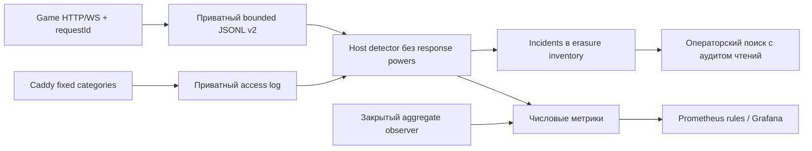

# Журналирование и расследования MoonGame — 2026-10-30

Решение для одного VPS и направление роста; текущий контракт —
[ранбук](../../deploy/security/README.md), владельцы будущих этапов —
[security operations](../security-operations-roadmap.md).
Уведомления пока нужны только в панели; то, что не помещается на VPS, остаётся планом.

## Проблема

SecurityAudit раньше сохранял отдельные события в stderr с Docker-ротацией.
Пересоздание контейнера разрывало историю. Не было постоянного общего request/actor/
source контекста, достаточного покрытия HTTP4xx/5xx и независимого признака потерь.
По такой выборке нельзя надёжно отличить обычный вход, внешний тест и атаку;
нехватка записей не доказывает отсутствие нарушения. Имена тестовых аккаунтов сами
по себе не устанавливают оператора или его намерение.

## Проверенные первоисточники и принятые решения

| Источник | Вывод для нашей реализации |
| --- | --- |
| [OWASP Logging Cheat Sheet](https://cheatsheetseries.owasp.org/cheatsheets/Logging_Cheat_Sheet.html) | Отдельный security stream: время, действие, результат и корреляция; минимум данных, защита доступа, проверка потерь и log injection. Не собирать пароли/токены/raw payload; разрешённые тесты не исчезают из журнала |
| [OpenTelemetry Logs Data Model](https://opentelemetry.io/docs/specs/otel/logs/data-model/) | Разделить время события и наблюдения, иметь версию/источник/severity/event name и корреляцию. Наш JSON может быть отображён в эту модель, но не является OTLP exporter или distributed tracing; requestId не объявляется TraceId |
| [NIST SP800-61r3, final April2025](https://csrc.nist.gov/pubs/sp/800/61/r3/final) | Детект, расследование, реагирование и восстановление — связанный процесс с подготовкой и проверками. Срабатывание правила создаёт повод для анализа; автоматический исполнитель требует отдельной модели полномочий |
| [Prometheus alerting practices](https://prometheus.io/docs/practices/alerting/) | Небольшой каталог actionable правил, понятный экран причин и контроль самого сбора. Проверить quiet/потери/no-data сценарии, не превращать каждую игровую ошибку в тревогу |
| [Loki cardinality](https://grafana.com/docs/loki/latest/get-started/labels/cardinality/) | account/source/request/match не становятся индексными или metric labels. Только конечные event/rule labels; подробная корреляция остаётся в защищённых записях |
| [Caddy log](https://caddyserver.com/docs/caddyfile/directives/log), [log_append](https://caddyserver.com/docs/caddyfile/directives/log_append) | Формировать статические классы, удалять request/URI/headers/IP до записи, явно задавать mode/rotation. Реальное поведение проверять на pinned бинарнике, а не только поиском строк в конфиге |

Псевдонимизация уменьшает раскрытие данных, но не заменяет правовые основания и
географию обработки. Новые поля/сроки включены в
[реестр ПДн](../security/rf-personal-data-readiness.md); оператор и релизный допуск
этим техническим изменением не определяются.

## Сейчас: небольшой локальный слой

Producer переживает пересоздание контейнера благодаря постоянному тому. Actor
подтверждается сервером, target/source представлены HMAC, source меняется по UTC-дню.
Успешные auth и heartbeat имеют отдельные бюджеты, очередь и дневной объём ограничены.
Локальный detector сопоставляет последовательности, dedup run/sequence, проверяет
исчезновение входа и переполнение; root worker не вызывает Docker/SQL и не банит.
CLI и erasure сериализованы с delivery lock. Производные incidents удаляются вместе
со связанными actor/target, а не копируются в бесконтрольную вторую БД.

На fixture ~4MiB/15000 событий настоящий 96MiB/15%CPU unit завершился за 3.482s,
CPU527ms, peak33.4MiB. Это проверка единичного ресурсоограниченного запуска;
24h soak, высокая нагрузка и потеря хоста ею не подтверждаются.
Отдельный systemd запуск с UMask0077 проверил разрешения: UID473 читает только
числовой файл0644 и не получает доступ к журналам0700; UID/GID Game65532 сохранены.
Свежий том0755 также проверен с нормализацией до0700 без следования symlink.
Панель и 8 Prometheus rules provisioned из Git; receivers отсутствуют по выбору
владельца. Полный стек включается только при прохождении существующего guard,
локальный сбор от его доступности не зависит.

## Следующий этап при достаточных ресурсах

1. Отдельное хранилище/collector с собственной identity, authenticated TLS ingest,
   bounded spool/WAL, acknowledgement, dedup/replay и видимым lag/loss. Изоляцию
   проверять потерей/захватом игрового хоста, а не вторым контейнером на нём.
2. Критичный audit/outbox атомарно с доменным эффектом; отдельные append-only роли,
   внешняя защищённая история и согласованные retention/erasure/правила дел.
   Нынешний batch datasync не даёт такой атомарности или immutability.
3. Индексный поиск с персональным RBAC/MFA и аудитом доступа, независимый heartbeat,
   каталоги detections/suppression с owner/TTL и оценкой false positives.
   Распределённые/медленные попытки требуют более длинной корреляции и контекста,
   чем нынешнее 10min окно и дневной source.
4. Отдельные incident admission и scoped runbooks: отзыв конкретной identity,
   ограничение домена, controlled recovery с policy/receipt/остановкой/откатом.
   Алерт не получает общий shell/SQL и права на массовые санкции.

Приёмка роста: обрыв сети/collector, дубли и spoofed producer, заполнение spool,
clock skew, потеря игрового хоста, quiet и разрешённый тест, erasure/replay и
неизвестный исход response. До этого SIEM/независимое реагирование остаются SE-8.4/8.5,
а не свойством установленного локального worker.
