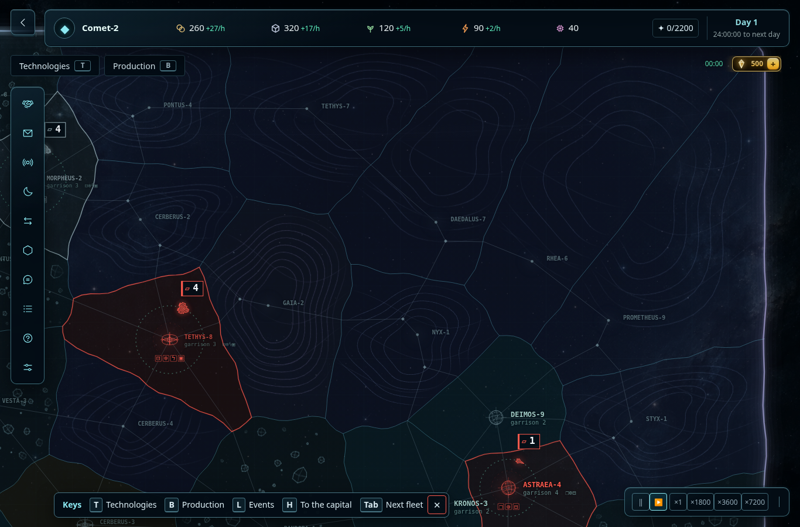
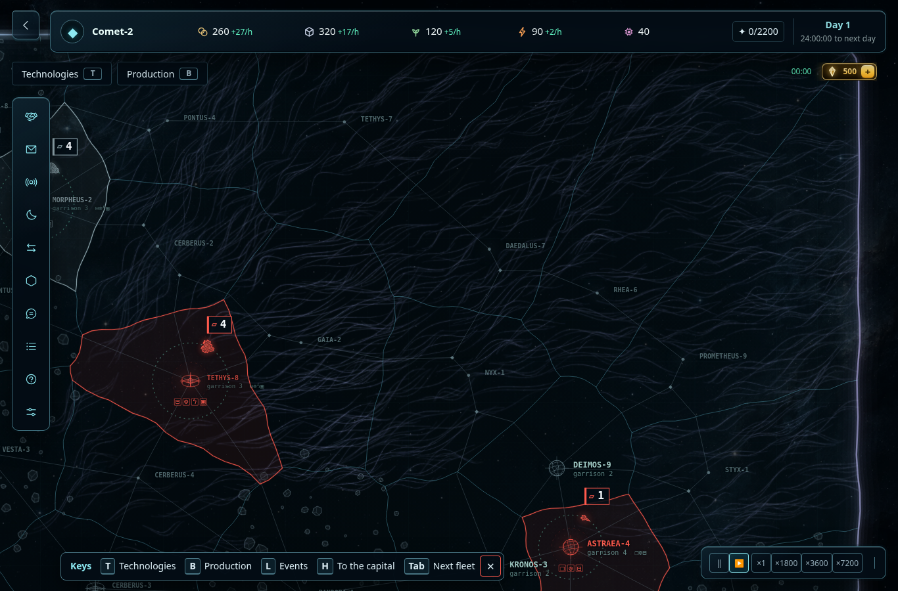
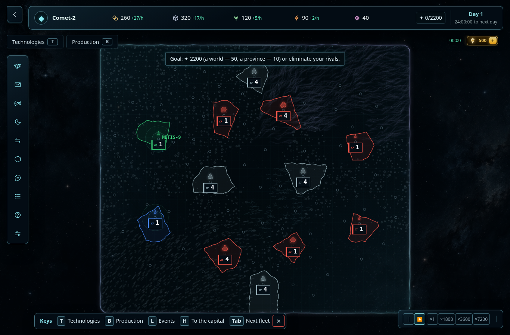
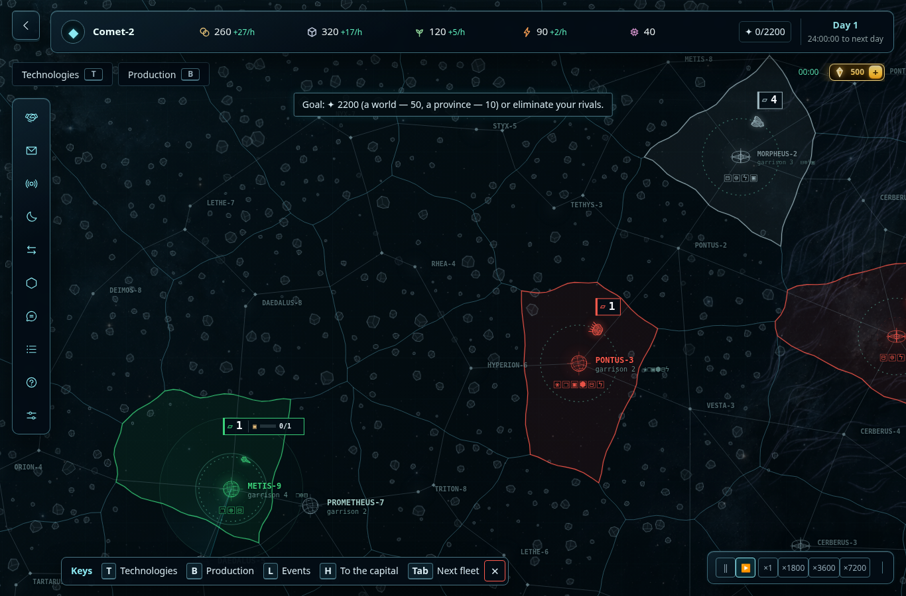
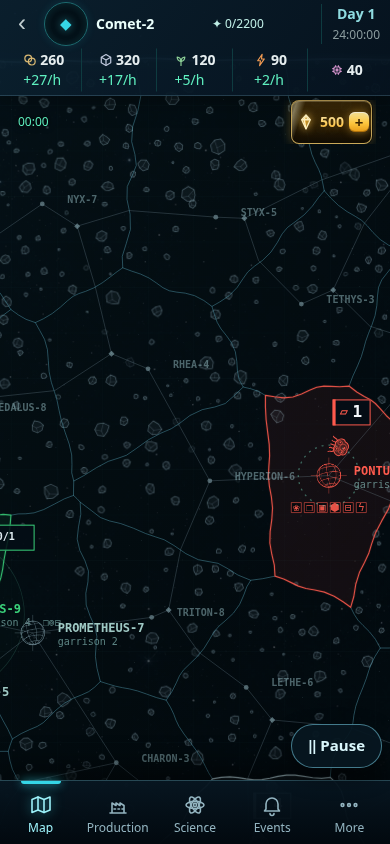
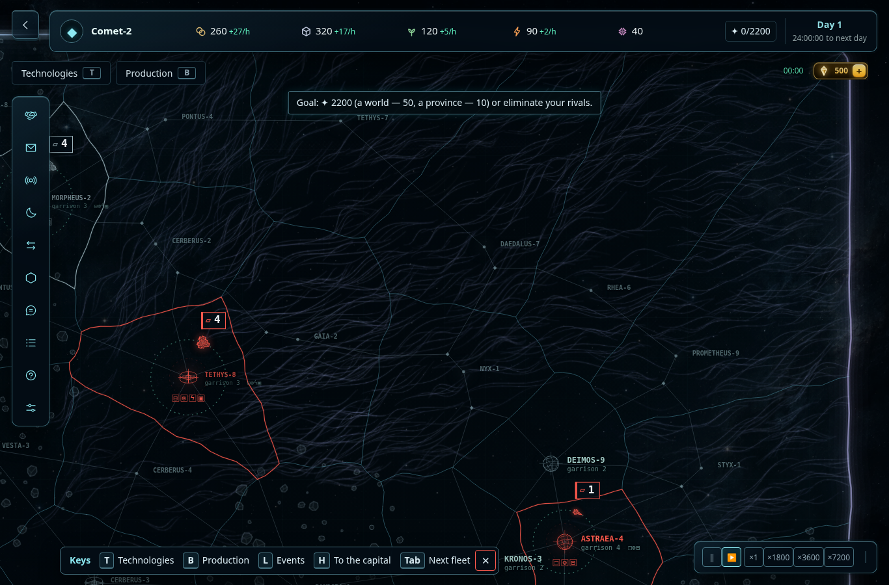
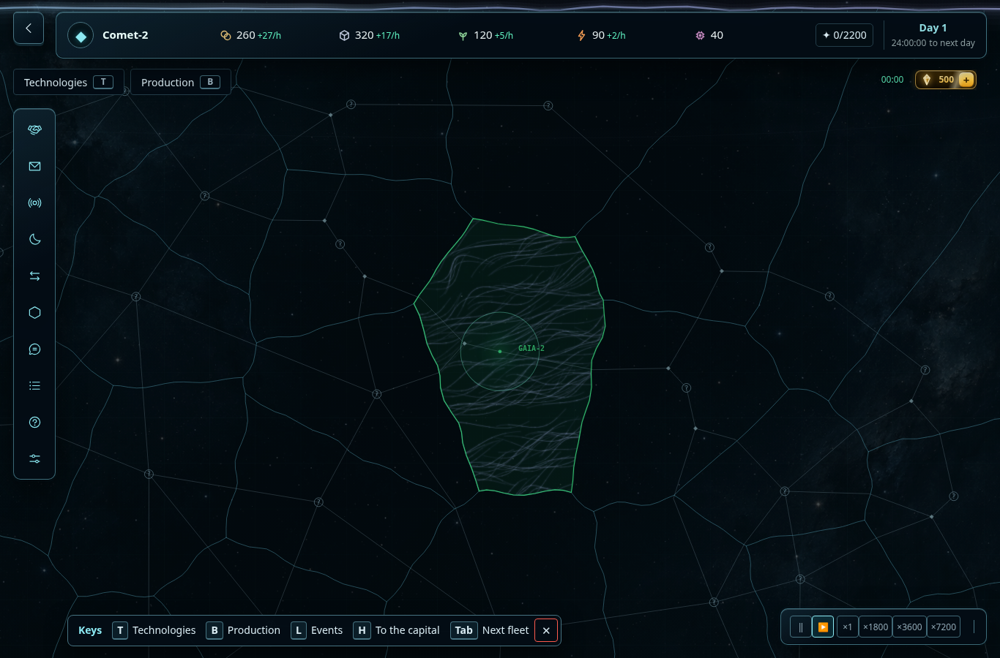
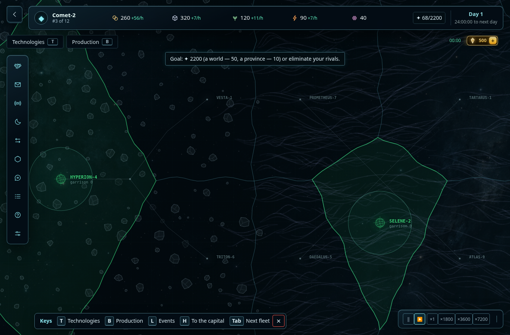

# Приёмка непрерывного окружения карты — 2026-10-14

Проверена первая реализация [правила визуальной непрерывности](../map-visual-continuity-rule.md)
в действующем прототипе. Общие астероидные поля и туманности теперь проходят через границы
провинций; обзор сохраняет географию. Игровые дороги остаются отдельным тактическим слоем.
Это датированный отчёт о проверенных сценариях, а не утверждение, что все пункты AC закрыты.

## Условия и воспроизведение

Снимки получены Chromium через `prototype/harnessKit.mjs` и `instrumentedGame` из реального
`prototype/src/main.ts`. PNG не перерисованы, не смонтированы и не сгенерированы.
Исходный и итоговый бандлы фиксировались отдельно; камера, размеры экрана и состояние
одинаковы в сравнении. Во временном тестовом хуке:

1. Через обычный UI выбиралась карта и запускалась партия; затем создавался свежий
   `newGame(buildSetupConfig())` через `startMatch(..., false)`.
2. Симуляция останавливалась (`speed = 0`, время мира 0). `hologramTime = 1000`.
   Полный обзор включался только sandbox-хуком: `enabled = true`, `fog = false`,
   `forgetVision()` и `refreshVision()`.
3. Время `renderMap` начиналось с 1000 и увеличивалось на 1000 после каждого изменения
   камеры, чтобы завершилась подготовка кэша. Во время снимка оно неизменно.
4. После установки камеры ожидались готовность карты и `mapSettled`. Не добавлялись
   production-экспорты, тестовые поля в `GameState` или сохранения партии.

Desktop: **1366×900, DPR 1**. Телефон: **390×844, DPR 1**; итоговый мобильный снимок
с `isMobile: true`, `hasTouch: true`, проверенным `(pointer: coarse)`.
Это эмуляция браузера, не замер физического телефона.

| Карта | Сценарий | Центр в координатах карты | Масштаб камеры |
| --- | --- | --- | --- |
| `duel-1` | обзор / тактика | стандартный fit / `(100, 80)` | 1 / 2.4 |
| `ffa-4` | обзор / смешанный край | стандартный fit / `(-250, 100)` | 1 / 2.4 |
| `team-2v2` | обзор | стандартный fit | 1 |
| `team-2v2` | астероиды | `(-1000, -1300)` | 3 desktop / 5 телефон |
| `team-2v2` | туманность | `(1350, -1460)` | 3 desktop / 5 телефон |
| `team-2v2` | особый объект и развилки | `(350, 430)` | 3 |
| `team-2v2` | разведанная туманность у неизвестного соседа | `(852, -1369)` | 3 |

## Точные кадры

Туманность **до**: отдельные концентрические образования повторяются внутри провинций.

Тот же участок **после**: общий рисунок с переменной длиной и кривизной нитей; политические
границы проходят поверх среды. Дороги и настоящие узлы остаются различимыми.

Обзор 2v2 сохраняет крупные области; раньше обзорный LOD полностью скрывал декор.

Астероиды не обрезаются по административным границам; у точек взаимодействия остаются просветы.

Телефон с сенсорным вводом и системным профилем coarse pointer.

Туманность без политической заливки. Только во временном хуке пропущен `drawTerritory`;
владельцы, геометрия, пути и среда не менялись. Тактические границы оставлены.

Граница разведки: известна захваченная `reach_74`, соседняя `reach_75` неизвестна.
Здесь остановка декора по границе видимости намеренна: продолжение не раскрывает скрытый тип.

## Синтетический сценарий топологии (AC-07/08)

Для одновременного сравнения использован отдельный временный browser fixture, **не карта
из опубликованного каталога и не новая игровая карта**. Штатный `installMatch` получил
12 провинций: 8 проверочных точек и 4 крайних точки для рамки. Через настоящие
`Planet.roads.crossings` / `trails` заданы следующие связи; production-код не менялся.
Камера `(80, 0)`, масштаб 1.6, экран 1366×900, время мира остановлено на 0.

- Слева B связан с A и C одной тропой с развилкой `(-390, 0)`. На кадре её ромб находится
  примерно в `(348, 481)` пикселях.
- Справа независимые дороги D↔E и G↔H пересекаются в `(550, 0)`. Соединения между этими
  парами нет. Пересечение примерно в `(1018, 481)` пикселях не имеет ромба: в отличие от
  левой развилки, один X не обещает возможность свернуть.
- Планетная точка P находится в `(550, 165)`, примерно `(1018, 599)` на экране, ниже
  пересечения. У неё `links=[]`; дорога проходит мимо отдельного кругового маркера.
  Наличие политического владения P не добавляет подъезд.

Харнес проверил ровно один `forkMark` (B, trail 0, exits A/C), независимые списки связей
D/E и G/H, отсутствие связей P и ошибок браузера. Различение использует форму маркера,
а не разные цвета дорог. Сценарий проверяет отображение и данные топологии; игровое
перемещение флота по этому искусственному fixture не запускалось.

## Матрица AC

«Тест» означает проверяемый контракт в указанном исходнике; визуальная оценка относится
к зафиксированным выше сценариям. Частичные пункты не считаются полностью принятыми.

| Критерий | Подтверждение | Результат и граница проверки |
| --- | --- | --- |
| AC-01 — единая среда | Визуально; `terrainEnvironment.test.ts` | Общий астероидный массив и туманность без островка на каждую ячейку. Разделённая на два соседних полигона среда даёт те же элементы, что целый полигон. |
| AC-02 — плотное ядро и открытый край | Тест; визуально | Плотность, размер и контраст различаются; переход разрежается. Проверены профиль плотной туманности и астероидов, а не весь каталог сочетаний. |
| AC-03 — туманность рядом с камнями | Тест; визуально | Сохраняются отдельные сигнатуры нитей и каменных силуэтов; смешанный край не усреднён до одного типа. |
| AC-04 — тройной стык и малая провинция | Тест | Нормализована суммарная плотность, малая провинция сохраняет внутренний профиль. Отдельный увеличенный браузерный кадр именно тестового тройного стыка не снят. |
| AC-05 — соседство без дороги | Тест | Деление сплошного массива общей границей без дороги не меняет рисунок. Новые дороги декор не создаёт. |
| AC-06 — дорога в плотной среде | Тест; визуально | Контраст подавляется возле настоящих полилиний без сдвига элементов; центр фиктивной диагонали между концами ломаной не очищается. Нет ровной пустой трубы вдоль всей трассы. |
| AC-07 — развилка и независимое пересечение | Браузерный fixture; тесты дорог | В синтетическом сценарии настоящая развилка имеет ромб, пересечение независимых D↔E и G↔H не получает маркера. Проверено, что renderer возвращает ровно один `forkMark`, относящийся к B. |
| AC-08 — боковой обход точки | Браузерный fixture; тест полилиний | В том же сценарии дорога проходит в стороне от P: её отдельная планетная точка видна ниже пересечения, `P.links` пуст. Декор не притягивает маршрут к P и не рисует ответвление. |
| AC-09 — непроходимая провинция / особый объект | Тест; визуально | В центральном участке 2v2 сохранён символ чёрной дыры и отсутствие дороги через неё; planner не заменяет объекты декором. Весь каталог особых объектов отдельно не просмотрен. |
| AC-10 — смена владельца | Браузерный тест; тесты кэша | После передачи `reach_74` игроку `p1` сигнатура сцены осталась `4932ab1e`. Та же сигнатура с выключенной политической заливкой. |
| AC-11 — скрытый сосед | Браузерный тест; тесты разрешённого представления | При трёх известных провинциях замена скрытого terrain у соседней `reach_75` не изменила сигнатуру `b9b18d5`. Тесты отдельно проверяют неизвестные метаданные, память разведки и ключ кэша. Побитовое равенство всего анимированного экрана не утверждается. |
| AC-12 — камера, кэш, повторный вход | Браузерный тест; тесты | Переход NE → обзор → NW → NE сохранил сигнатуру `4932ab1e`; видимых новых швов не обнаружено. Тесты проверяют целые силуэты на границе плитки, пересборку растра, панорамирование, resize и повторное построение. |
| AC-13 — desktop / телефон / упрощение | Визуально; тест painter | Desktop и touch-эмуляция сохраняют дороги и типы; упрощённый painter убирает только мелкие элементы, сохраняя основные контуры. Физические устройства не проверялись. |
| AC-14 — локальное редактирование | Тест | Изменение далёкой местности/дороги не меняет независимые плитки; разрешённые изменения инвалидируют нужный кэш. Интерактивный редактор отдельно не запускался. |
| AC-15 — неизменность симуляции | A/B-тест на трёх картах | `terrainSimulation.test.ts`: одинаковые старты, конфиги и действия; во второй ветке между шагами строится разрешённое окружение. Совпадают результаты действий/событий, хеши после шагов и итог матча. Проверены реальное наличие декора и неизменность графа/типов. Срок партии сокращён до 48 игровых часов; длительный self-play не выполнялся. |

Источники контрактов:

- [Планировщик среды](../../decisions/terrainEnvironment.test.ts).
- [Разведка, кэш сцены и проекция прототипа](../../prototype/src/terrainEnvironmentView.test.ts).
- [Общий painter](../../packages/client/src/terrainEnvironmentDraw.test.ts).
- [Интеграция клиента](../../packages/client/src/mapRenderEnvironment.test.ts).
- [Растровый кэш](../../prototype/src/terrainRasterCache.test.ts).
- [Дороги и маркеры развилок](../../decisions/roadNetwork.test.ts).
- [A/B-прогон симуляции всех трёх карт](../../prototype/src/terrainSimulation.test.ts).

## Производительность

Один headless Chromium в облачном Linux, DPR 1, карта 2v2, центр туманности `(1350, -1460)`,
масштаб 3 desktop / 5 touch. Исходный и итоговый бандлы запускались последовательно.
Для каждого режима записано 95 `requestAnimationFrame`, первые 5 интервалов исключены.
Панорамирование: смещение центра по синусу/косинусу на ±220/140 единиц; zoom: ±25 %.
Мир стоял на времени 0. Это короткий сравнительный probe, без аппаратной калибровки и
без эксклюзивного владения CPU машины.

**CPU `renderMap`** — время самого вызова, измеренное `performance.now()` один раз в обычном
кадре. Оно не включает всю работу HUD, асинхронное выполнение GPU и представление кадра.
**Интервал rAF** — наблюдаемая периодичность callbacks; это другой показатель, не CPU-время.
Значения ниже в миллисекундах; стрелка означает «до → после».

| Экран / действие | CPU медиана | CPU p95 | Интервал rAF медиана | Интервал rAF p95 |
| --- | --- | --- | --- | --- |
| desktop / покой | 2.0 → 1.9 | 2.7 → 2.5 | 16.7 → 16.7 | 33.4 → 33.4 |
| desktop / панорамирование | 2.4 → 2.3 | 3.7 → 3.2 | 16.7 → 16.7 | 33.4 → 33.4 |
| desktop / масштабирование | 2.3 → 2.4 | 10.2 → 7.7 | 16.7 → 16.7 | 33.4 → 33.4 |
| touch / покой | 1.2 → 1.4 | 1.6 → 1.8 | 16.7 → 16.7 | 16.8 → 16.8 |
| touch / панорамирование | 1.9 → 1.8 | 2.8 → 2.4 | 16.7 → 16.7 | 16.7 → 16.8 |
| touch / масштабирование | 1.7 → 1.7 | 2.7 → 4.5 | 16.7 → 16.7 | 16.8 → 16.7 |

Максимальный CPU-вызов итоговой версии: 14.5 мс desktop и 6.2 мс touch; максимальный
наблюдённый rAF-интервал: 33.4 мс desktop и 16.8 мс touch. Небольшой рост медианы CPU
есть в нескольких сценариях. По этому короткому прогону нельзя обещать стабильные
60 FPS, отсутствие редких задержек или такой же результат на телефоне: нужны целевые
устройства и более продолжительные замеры.

## Ограничения приёмки

В просмотренных кадрах и браузерных сценариях не обнаружены обрезанные административной
границей камни, перестановка крупных элементов после изменения камеры/владельца или утечка
скрытого terrain через новую среду. У первой промежуточной версии туманность выглядела как
одинаковые прямоугольные пачки штрихов; в итоговых кадрах они заменены нерегулярными
извилистыми нитями с затуханием концов.

Остаются длительный self-play, расширенный просмотр особых объектов и измерения
на целевых физических устройствах. Сценарий AC-07/08 синтетический: он не подтверждает
проходимость искусственной раскладки как полноценной игровой карты.
Визуальная браузерная приёмка относится к прототипу; второй клиент покрыт контрактными тестами
интеграции и общего painter, но не отдельной серией браузерных снимков.
