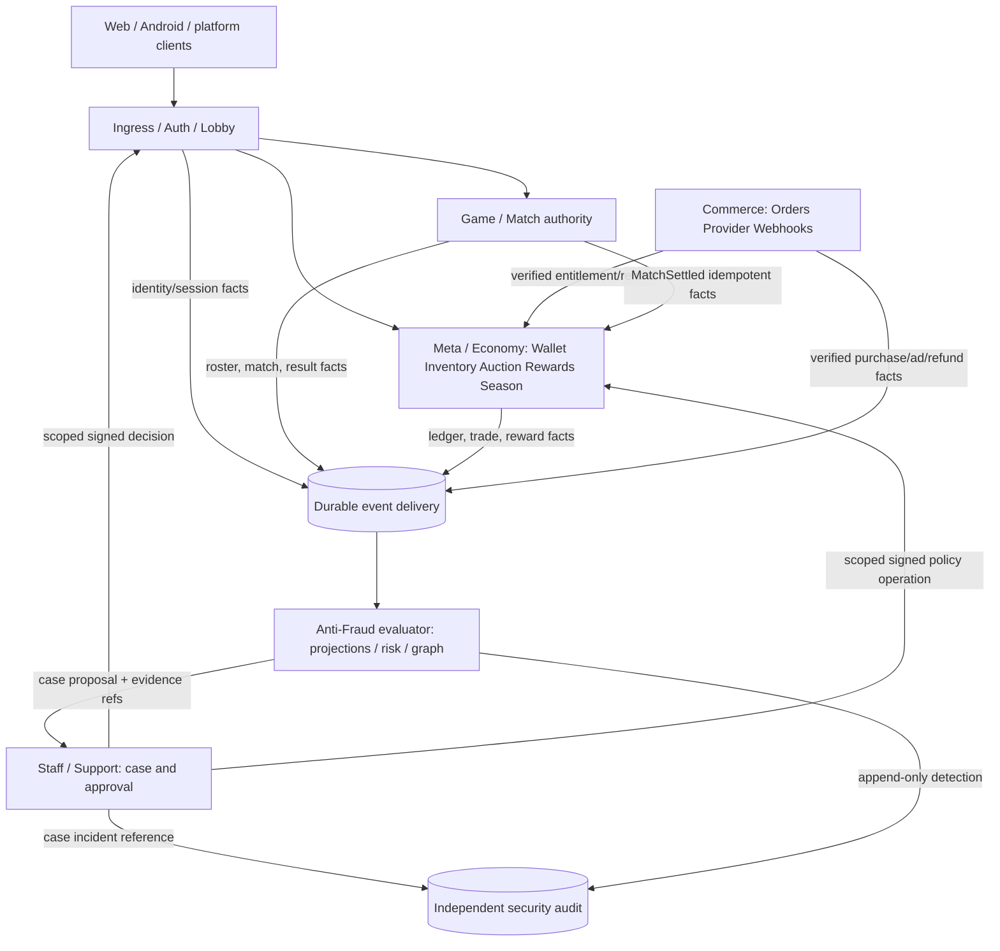

# Anti-Fraud и мультиаккаунты — политика и архитектура

Проектное решение для основной многопользовательской Void Dominion: защита экономики, матчей и корпораций от злоупотреблений идентичностями.

> **Статус: целевой дизайн / план, 2026-10-16. НЕ реализованный Anti-Fraud.**
> Существующие серверные контроли и ограничения перечислены ниже отдельно.
> Ответственные кирпичи: [GI-2.1/2.3/3.1](../game-integrity-roadmap.md),
> [EC-0.3/3/6.1](../economy-roadmap.md), [AC-2.3](../accounts-roadmap.md),
> [MM-2.1/3.1](../matchmaking-roadmap.md), [OPS-4](../staff-case-roadmap.md).
> Это **спецификация**, не разрешение включить санкции без правил, тестов и модерации.

## 1. Цель, область действия и принцип

**Цель:** дополнительная учётка не должна давать выгодный способ печатать мета-ценности,
отмывать Варранты, накручивать рейтинг или получать несколько армий/окон разведки
в одной соревновательной партии. Обнаружение связей помогает, но основная защита —
**выгодная эксплуатация должна быть перекрыта серверными инвариантами**.

- **Основная Void Dominion:** долгие асинхронные матчи, аукцион, межматчевые
  Rewards/Inventory/Wallet, Season Pass, корпорации, будущие рейтинг/AvA.
- **Sector Zero:** отдельный PvE/профиль платформы (включая полноценных гостей);
  **не** привязываем его к серверному логину основной игры и не смешиваем кошельки.
  См. [platform-adapters.md](../platform-adapters.md) и
  [sector-zero-economy-roadmap.md](../sector-zero-economy-roadmap.md).
- **Не цель:** доказать, что у человека ровно один аккаунт; блокировать семьи,
  общие сети, VPN, мобильные сети или пользователей одной точки доступа.
- **Правило продукта, предлагаемое к утверждению:** один *человек-оператор* может
  занимать только **одно место в публичном соревновательном матче**, вне зависимости
  от разных логинов/платформ. Совместная сговорная игра вторыми аккаунтами ради
  наград/рейтинга/тумана запрещена. Сам факт второго аккаунта вне этих сценариев
  не является автоматическим основанием для бана.
- Если доказать общий контроль нельзя, **не утверждать его автоматически**:
  скоринг создаёт сигнал к проверке, а не юридическое/дисциплинарное доказательство.

## 2. Реальная база и известные пробелы

| Уже есть на `main` / в проектных решениях | Пока отсутствует или не подтверждено |
| --- | --- |
| Серверный actor/accountId, проверка полномочий и WS-гейт, фильтрация FoW, per-player rate-limit | Граф связанных аккаунтов, регулярная анти-сговорная проверка |
| Идемпотентные мета-награды с receipt, серверное происхождение и правила soulbound, дневные/этапные бюджеты (см. `economy-roadmap.md`) | Anti-Fraud политика выдачи и обжалования санкций |
| `MetaMarket` Memory+Postgres, атомарный trade/комиссия/перенос, `tradeId` receipt, торговый допуск по XP, нулевой регистрационный faucet | Лимиты/скоринг пар продавец↔покупатель и потоков стоимости |
| Commerce выделен отдельно от транзакционного Meta/Economy; рекламный провайдер и реальные платежи ещё не включены | Verified provider fraud-review, anti-ad-farm сценарии |
| Security JSONL и планы SIEM/Staff | Anti-Fraud кейсы, защищённая оценка риска и ограниченные ручные решения |

**Нельзя переименовывать эти пробелы в «готово»** только из-за наличия таблицы правил.
Описание реализации и актуальные статусы — у связанных роадмапов.

## 3. Сценарии злоупотреблений и первичный барьер

| Сценарий | Защита правилами продукта/транзакцией | Детекция и реакция |
| --- | --- | --- |
| Массовые регистрации ради стартового капитала | Нет биржевой валюты за регистрацию (`META_MARKET_FAUCET=0`); стартовые/рекламные бонусы soulbound, транзитивный запрет переработки в торгуемое | Registration velocity и ранний транзит ценностей, гибкий антибот-гейт на auth |
| Несколько аккаунтов фармят награды за подставные бои | Receipt на `(matchId, accountId, rewardKind/phase)`, общий этапный бюджет, подтверждённое участие; один источник наград | Повторные пары, сдачи, быстрые победы, результат vs доказанные действия, граф матчей |
| Пять своих мест в одной партии = пять флотов и общий FoW | Один `accountId` не занимает два места; правила общего оператора для публичной соревновательной партии; условия наград независимы от числа контролируемых аккаунтов | Связи в roster до старта, повторяющиеся согласованные действия/сливы разведданных; ручной разбор |
| Wash trading: альты покупают лот с завышенной ценой | Атомарный trade, escrow, комиссионный sink, серверная проверка торгового права; при необходимости hold всей операции до settlement | Цена относительно сравнимых лотов, velocity/объём, пары контрагентов, циклы и концентрация стоимости |
| «Отмывка» через craft/разбор материалов | Серверный provenance каждого ресурса, `soulbound` транзитивен по входам, нет превращения ad/paid в биржевое | Проверка цепочек `source → transform → trade` по eventId/itemId |
| Несколько рекламных профилей ради наград | Verified rewarded callback, уникальный provider event ID, дневной лимит на аккаунт, только личная неторгуемая выдача | Повторы provider event, подозрительные bursts; не рассчитывать на клиентский `onClose` |
| Накрутка корпораций/AvA/сезона | Не оплачивать одно событие более одного раза, не выдавать силу только за число участников; один сезонный XP за UTC-день в заданной политике | Кластеры взаимного буста, повторные жертвенные команды/лиги |
| Реферальный фарм (если появится) | Награда после независимого подтверждённого прогресса; не создаёт торгуемую стоимость без экономического гейта | Повторные цепочки приглашений, недолговечные аккаунты, события без реальной игры |

**Важно:** отсутствие отдельного referral-сервиса, рейтингового режима или торгового
корпоративного контента сейчас — не повод считать гипотетическую детекцию готовой.

## 4. Политика участия в партиях — отдельно от детектора

Предлагаемый policy matrix; **не включён автоматически данным документом**:

| Тип партии | Дополнительные аккаунты под одним оператором | Результат и награды |
| --- | --- | --- |
| Публичная соревновательная / рейтинговая | **Не допускаются** два управляемых одним человеком места даже в разных командах | Рейтинг и торгуемые награды — только после integrity checks; санкция/откат по доказанному кейсу |
| Публичная нерейтинговая с мета-наградами | Тот же запрет фарма/сговора; не превращаем «нерейтинговая» в фарм-зону | Экономические ограничения такие же; критерии матчевого участия учитывают async/Хранителя |
| Частная учебная/тестовая (если реализуем) | Допустимы тестовые места и несколько устройств **при явно выбранной песочнице** | Нет рейтинга, торгуемых наград, Season XP и transferable progress |
| Обычный PvE Sector Zero | Только собственная платформа/локальный профиль; общих соревновательных слотов нет | Собственная награда Sector Zero, отдельный кошелёк |

### Как проводить решение без наказания семьи

1. На join сервер жёстко проверяет `accountId` и места — один account на матч
   не должен иметь два независимых seat. Это **не** доказательство «один человек».
2. По кластеру **слабых** сигналов (общий IP, NAT, устройство, часы входа)
   показываем внутренний риск, а не блокируем автоматически.
3. Перед распределением соревновательных наград проверяем признаки **связи плюс
   эксплуатационного эффекта**: однотипные договорные победы, объём переводимой
   стоимости, выгодоприобретатель, необъяснимые стратегические координации.
4. Для high-risk кейса — проверка оператором по минимальному набору доказательств.
   В сомнительном случае не запрещаем игру по одному совпадению сети.
5. В случае подтверждения — целевой откат незаконной награды/сделки, корректировка
   рейтинга и пропорциональная санкция, а не уничтожение всего инвентаря.

**Разведка через второй аккаунт:** корректный FoW шифрует/фильтрует серверные виды,
но не решает сговор нескольких реальных seats. Защищаем *целостность состава партии
и наград*, не обещаем техническое предотвращение обмена сведениями между людьми.

## 5. Контуры и trust boundaries

После решения 2026-10-15 **не выделяем Auction из Meta/Economy** и не даём
Anti-Fraud прямых прав на кошельки. Commerce — отдельный платёжный trust boundary.



**Синхронная защита (остаётся у владельца домена):**

- Auth/Lobby: аутентификация, уникальность seat/accountId, допустимые слоты, лимиты.
- Match: серверные права, завершение, подтверждённые события участия, match receipts.
- Meta/Economy: inventory ownership, provenance, trade atomicity, ограничение issuance,
  ledger conservation, idempotency, проверяемая оценка политики *перед commit*.
- Commerce: verified provider callback/signature, transaction uniqueness, refund/
  chargeback handling. Клиентский успех не создаёт доверенного entitlement.

**Асинхронная защита (Anti-Fraud):** сбор типизированных событий, агрегаты/граф связей,
оценка риска, создание кейса, объяснимые доказательства и метрики. По умолчанию
detector **не пишет** в ledger, profile, ranking или grant напрямую. Если детектор
недоступен — детерминированные локальные инварианты продолжают работать.

**Развёртывание:** сначала модули + события/таблицы внутри имеющихся границ
`packages/server` (или отдельный безопасный consumer), без нового публичного
endpoint и без новой межсервисной транзакции. Выделять детектор в сервис при росте
потоков/потребности в независимых ACL, не ради схемы. Его read model — не source
of truth для баланса и судебных решений; только ограниченный scoped command через
доменное API и Staff для подтверждённой санкции. Для будущего разнесения нужен
outbox/inbox + dedup + replay-safe consumers.

## 6. События, receipts, хранение

Минимальный `FraudSignalEnvelope v1` (эскиз, не готовый TypeScript контракт):

```json
{
  "eventId": "immutable-uuid-or-domain-receipt",
  "version": 1,
  "source": "meta-economy",
  "kind": "trade.settled",
  "occurredAt": "2026-10-16T00:00:00Z",
  "actorAccountId": "acct-pseudonym",
  "subjectAccountId": "counterparty-pseudonym",
  "scopeId": "trade-id",
  "traceId": "request-correlation-id",
  "facts": {"itemClass": "blueprint", "warrants": 150},
  "policyVersion": "af-v1"
}
```

Для конкретного события поле `subjectAccountId` и `facts` ограничиваются
позволенными нужной проекции атрибутами; PII/секреты/токены в него не попадают.
`occurredAt` назначает доверенный producer, eventId уникален и индексирован;
время получения сохраняется отдельно для задержанных сообщений. Payload/schema
версионируются, неизвестные версии не провоцируют автоматические санкции.

Потоки:

- `auth.registered/login.failed/session.created` (не сохранять пароль, JWT, raw UA).
- `match.joined/started/ended/seat.changed` и проверяемые события участия/результата.
- `reward.pending/settled/reversed`, `season.xp.granted`.
- `trade.listed/purchased/cancelled`, `wallet.transferred`, `item.provenance.updated`.
- `ad.reward.verified`, `commerce.entitlement.verified/refunded`.
- `corp.member.changed`, `ava.result.settled` — только когда контур есть.

**Инварианты доставки:**
- Состояние кошелька, резервы, комиссии, item transfer, итоговый receipt фиксируются
  атомарно внутри владельца Meta/Economy; публикуем событие через outbox (когда включён).
- At-least-once consumer обязан дедуплицировать eventId; отсутствие события в
  аналитике не повод повторно выдавать или откатывать награду.
- Стабильный `rewardKey=(matchId, accountId, rewardKind, phase)` или
  существующий эквивалент; provider IDs idempotent и scope по провайдеру.
- Сопоставление ledger balances vs issued/spent/burned — отдельная регулярная
  сверка, обнаруживающая дюп и пропавшие receipts.
- Replay кейса читает неизменяемые факты/ревизии политики, не доверяет полям клиента.

## 7. Сигналы связей и модель риска

| Класс | Возможные сигналы | Ограничение |
| --- | --- | --- |
| Идентичность | Проверенная связь нескольких login/provider identity с одним Account | Несколько способов входа в **один** Account — легитимно, не Sybil |
| Сеть | Частота регистраций по краткоживущему сетевому псевдониму | CGNAT, семьи, VPN/провайдеры; IP **не** доказательство общего оператора |
| Устройство/клиент | App integrity attestation при поддержке площадки, грубые тех. признаки | Аттестация подтверждает приложение/среду, не уникального человека; не строить тайный persistent fingerprint |
| Поведение | Общий граф сделок, повторные соперники, синхронная игра, слив побед, серия жертвенных матчей | Друзья/команды тоже играют вместе; обязателен контекст выгоды |
| Экономика | Завышение цен и маршруты `alt → intermediary → beneficiary`, высокая концентрация | Легитимная редкая вещь не равна отмывке; учитывать ликвидность, объём и класс предмета |

**Риск — не одно число без объяснения.** Внутренние признаки агрегируются по
типу злоупотребления (trade-abuse / match-collusion / registration-farm /
reward-farm); каждый case хранит `detectorVersion`, сигналы, eventIds,
влияние на экономику и способ объяснения решения. Пороги настраиваются и
калибруются в закрытой конфигурации по живым данным; не «магическое 80/100».

**Режимы:** observe-only → shadow decisions → мягкая friction/holds →
ручной review → ограниченная автоматизация только доказуемых повторных событий
(например, replay одного provider event или повтор той же награды).

## 8. Реакция, fairness и failure modes

| Уровень | Допустимая реакция | Правило |
| --- | --- | --- |
| Низкий риск | Только наблюдение, ограниченная защита от burst регистрации | Без штрафа |
| Средний риск | Защита массовых регистраций, доп. проверка при спорной операции | Не превращать IP-совпадение в бан |
| Высокий риск + доказуемая экономическая операция | До commit: **атомарно** отклонить/отложить **всю** сделку, а не списать и потерять предмет | Hold только при реализованном owner-controlled state machine со сроком/освобождением и статусом для пользователя |
| Подтверждённый кейс | Scoped reversal недобросовестных наград/рейтинга, предупреждение, временное ограничение, бан за повтор/тяжёлый случай | Case ID, версия правил, авторизованный reviewer, audit, апелляция |

**Обязательные правила отказа:**

- Неавторизованная покупка/ложный receipt/payment → fail closed всегда.
- Недоступный detector → стандартные локальные лимиты и инварианты действуют;
  никакой необъявленной заморозки всех честных выплат.
- Недоступная доставка в Staff/SIEM → spool и ретраи bounded, не выдавать права
  из-за ошибки и не терять финансовый receipt.
- Подтверждённое провайдером платёжное право нельзя «потерять» от подозрительного
  risk score: разбор fraud отдельно от корректного refund/dispute процесса.
- Для hold фиксируются TTL, точное состояние `pending/released/rejected`,
  ответственный и точка окончательного решения **до** включения фичи.
- Ручная санкция — только через [case-bound Staff](../staff-case-roadmap.md),
  минимальная роль + срок + журнал служебных действий. Detector/analyst не получает
  прямого SQL-write к кошельку, а user-visible причина не раскрывает секретные правила.

**Апелляция:** игрок получает понятный вид ограничения и канал оспаривания;
разбор использует сохранённые проверяемые факты, исход и корректировку. Удаление
аккаунта, экспорт данных и сроки хранения согласуются с AC-2.3/SE-10 до прода.

## 9. Приватность и защита Anti-Fraud

- Отделить продуктовую аналитику (без PII) от ограниченного security/anti-fraud
  хранилища. Доступ: только служебные роли с необходимостью; case-scope и аудит.
- Хранить `accountId`, ограниченные eventIds/traceId и допустимые доказательства.
  Сетевые сигналы — по возможности временные HMAC-псевдонимы с ротацией ключа,
  ограниченными окнами и предусмотренным механизмом удаления. Сам по себе hash IP
  **не** делает данные неперсональными; raw IP/полный device fingerprint по умолчанию
  не собирать без отдельно утверждённой необходимости и правового основания.
- Отдельные retention policy по классу данных (raw signals кратко; подтверждённые
  кейсы и ledger receipts — по законной цели и требованиям), процесс доступа,
  экспорта/удаления, audit-evidence exception и уведомление в privacy notice.
- Не считать shared NAT, браузерную смену устройства или VPN доказательством.
  Реализовать тесты на ложноположительные для домохозяйства, клуба и мобильной сети.
- Anti-Fraud-проекции не получают payment secrets, refresh tokens, пароли,
  ключи восстановлений, полный auth audit и доступ к чужим SQL-схемам.
- Игровой `shared-core` остаётся детерминированным: detector/скоринг,
  real-time clock, IP и статистика пользователей никогда не входят в `applyAction`.

## 10. План внедрения — без ненужного микросервиса

| Этап | Что делаем | Связь с текущими задачами | Критерий готовности |
| --- | --- | --- | --- |
| AF-0: policy/design | Утвердить матрицу типов матчей, правила альтов, санкций, retention и метрик | GI-2.1, GI-3.1, AC-2.3 | Правила понятны игроку и проверяемы тест-кейсами |
| AF-1: бесспорные инварианты | Seat uniqueness; reward/ad/payment idempotency; provenance/soulbound; receipt reconciliation | GI-0.2, GI-2.3, EC-3/6 | Повтор регистрации/settlement/trade/provider callback не создаёт ценности; race-тест |
| AF-2: event contract | Versioned eventId, durable bounded outbox/inbox, аудит и безопасные проекции, метрики | GI-1.1, SE-8, PE-1.1 | Повторы/рестарт не теряют факт и не удваивают операции |
| AF-3: shadow risk | Trade graph + match collusion signals, baseline на честных игроках | GI-2.1, GI-1.2, EC-6.1, MM-2.1 | Сценарии мультиаккаунт-фарма обнаружены при контролируемом FP |
| AF-4: controlled response | Staff case/review, scoped hold/reversal, appeal, playbooks | GI-1.3/3.1, OPS-4 | Доказательства и доступы аудируются, апелляция и аварийное снятие работают |

**Метрики:** число доказанных farm-схем, сумма предотвращённой выдачи/откачки
ценности, precision подтверждённых кейсов, доля невиновных среди эскалаций,
время review и апелляции, задержка честной сделки, доля ошибочных hold, матчевые
поломки/отток после проверок. Максимизировать число банов — **не** метрика успеха.

## 11. Приёмочные сценарии

- [ ] Один `accountId` не может занять два независимых места в одной партии;
      одно физическое устройство/общий IP **не** блокирует двух разных игроков.
- [ ] 5 новых учёток не генерируют передаваемую стартовую ценность; craft и
      разбор не снимают `soulbound`, в том числе после нескольких цепочек.
- [ ] Повтор `MatchSettled`/этапного события после restart даёт ровно один
      reward receipt; длинный idle/Хранитель не помечается читом автоматически.
- [ ] Повтор `tradeId`, гонка покупки одного лота и двойное списание не
      умножают Варранты или предметы; комиссия/передача атомарны.
- [ ] 10 wash-trades между связанными аккаунтами дают **кейс** и проверяемую
      цепочку событий; единичная дорогая редкая продажа не даёт автобан.
- [ ] Подозрительный private/sandbox матч не выдаёт ранговую/биржевую ценность;
      публичный матч с контролируемыми местами выдаёт управляемую проверку.
- [ ] Повторённый рекламный callback/provider transaction подтверждается
      максимум одним entitlement; неподписанный или непроверенный — ни одним.
- [ ] Недоступен detector/очередь событий: игра, авторизация и честная оплата
      не зависают; нет новых наград по непроверенному внешнему событию.
- [ ] Журнал кейса объясняет основание, rule version, reviewer, receipt и исход;
      право санкции проверяется per-case, доступ аналитика read-only.
- [ ] Повторная регистрация из общего NAT и совместная игра семьи не приводят
      к необоснованной блокировке/конфискации; апелляция исправляет ошибку.

## 12. Что остаётся согласовать до code enforcement

1. Точный текст пользовательских правил: один оператор/seat для публичных матчей,
   степень допустимости альтов вне публичных наградных матчей, отображение предупреждения.
2. Какие private/training комнаты доступны в первой версии, и должны ли они быть
   наградно изолированы или пока не создаваться вообще.
3. Бюджет ложных срабатываний, конфигурацию hold/TTL и критерии доказательности
   санкций; до этого включён только observe-only.
4. Окна/сроки хранения риск-сигналов, правовое основание и privacy notice по каждой
   целевой платформе.
5. Нужно ли отдельное разграничение economy/competitive sanctions от блокировки
   всего аккаунта, если у игрока несколько независимых игровых контуров.

Смежные документы:
[целостность игры](../game-integrity-roadmap.md) ·
[экономика основной игры](../economy-roadmap.md) ·
[карта сервисов](../service-architecture-map.md) ·
[раздельные security-контуры](../security-operations-roadmap.md) ·
[платформенные адаптеры](../platform-adapters.md).
