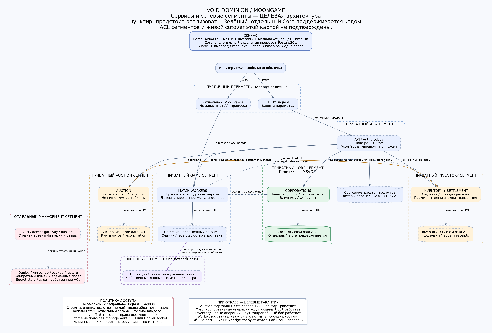
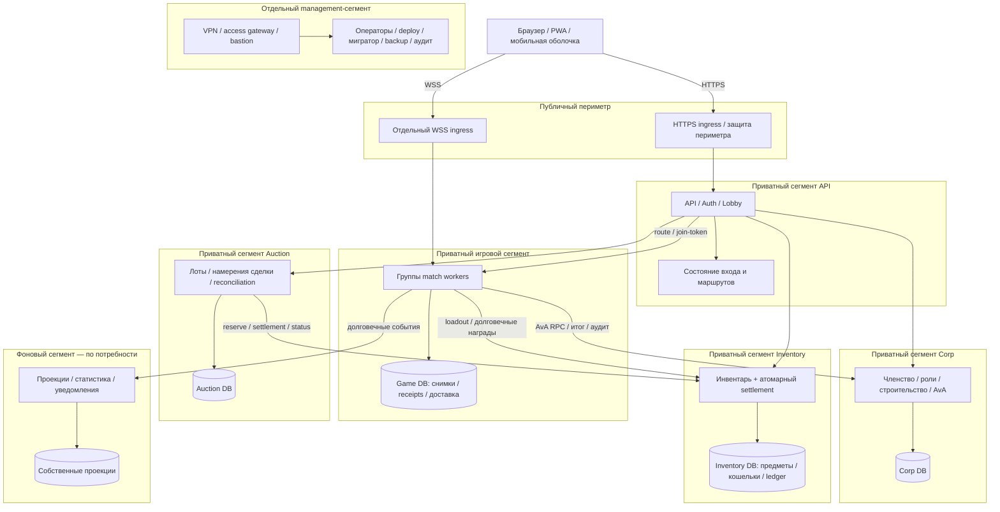

# Карта архитектуры — сервисы и сетевые сегменты

[Роадмап и задачи MSVC](service-resilience-roadmap.md) ·
[PNG](diagrams/service-boundaries.png) · [PDF](diagrams/service-boundaries.pdf) ·
[SVG](diagrams/service-boundaries.svg) · [Редактируемый DOT](diagrams/service-boundaries.dot).

Если SVG не отображается, используйте встроенный PNG или схему Mermaid ниже.
Эта страница и изображения хранятся в репозитории; для открытия не требуется путь
к файловой системе среды агента.

## Что есть сейчас

Game объединяет API/Auth/Lobby, матчи, личный инвентарь и fixed-price MetaMarket
с общей игровой БД. Corp поддерживает отдельный процесс и отдельную PostgreSQL;
его перенос и состояние живого сервера не подтверждены этой картой.
Исходящие обращения к Corp ограничены `DependencyGuard`.

Ниже **целевая** топология. Каждый блок сегмента означает отдельную политику доступа,
а не уже развёрнутый VLAN/контейнер/хост. Приватная сеть допускает только заданные
соединения; сетевое разрешение всегда дополняется проверкой identity и операции.
Общий физический хост, PG-кластер, DNS, edge или secret-store могут оставаться общей
точкой отказа: сегментация сама по себе не доказывает HA/DR.

## Схема прямо на странице

Для компактности stores нарисованы внутри доменных блоков. В реализации у каждого
store отдельный data-сегмент/ACL: подключается только владелец и конкретные временные
административные jobs. API/Auth/Lobby пока роль Game; его состояние, интерфейс
матч-браузера и перенос прорабатываются с SV-4.1/OPS-2.1. Это не объявление нового
самостоятельного Auth-микросервиса. Сборщик долговечных событий также остаётся ролью
владельца Game до появления причины отделить его.

## Целевая матрица разрешений

Это исходная матрица для MSVC-7. Точные endpoints, порты и механизм сетевого
enforcement фиксируются перед включением конкретного домена. Направление стрелки —
инициатор соединения; ответ в этом соединении не разрешает новую обратную связь.

| Источник | Назначение | Разрешённое назначение соединения |
| --- | --- | --- |
| Браузер | HTTPS ingress | Публичные игровые API по HTTPS; внутренние `/internal/*` не маршрутизируются |
| Браузер | Отдельный WSS ingress | Соединение с назначенным worker по join-token |
| HTTPS ingress | API/Auth/Lobby | Только опубликованные HTTP-маршруты; origin защищён от обхода ingress |
| WSS ingress | Назначенные workers | Только WS upgrade; независим от процесса API/Auth |
| API/Auth/Lobby | Workers / их маршрутизатор | Управление местом и маршрутом; scoped операции, без горячего пути боя |
| API/Auth/Lobby | Inventory | Личный инвентарь, equip/rent и другие команды с правами исходного actor |
| API/Auth/Lobby | Auction | Лоты и торговые намерения с подтверждённой волей продавца/покупателя |
| API/Auth/Lobby | Corp | Корпоративные команды с проверкой членства/ролей |
| Auction | Inventory | Только reserve/commit/cancel/status по стабильному ID и ограниченным полномочиям |
| Game/workers и роль доставки Game | Inventory | Loadout до старта; идемпотентная выдача/износ/возврат после результата |
| Game/workers и роль доставки Game | Corp | Ограниченные AvA RPC, доставка результата и аудита |
| Владелец Game / его роль доставки | Фоновые потребители | Версионированные durable события, без права выдать валюту от имени проекции |
| Каждый доменный runtime | Только собственный store | Собственная DML-роль, TLS и отдельный data ACL; никаких чужих таблиц/DDL |
| Оператор | Management access gateway | Отдельная сильная аутентификация, ограниченный срок, журнал и отзыв |
| Авторизованная management job | Конкретный хост/store | Deploy, миграция, backup либо restore своим набором прав; не постоянный доступ приложения |
| Runtime / job | DNS / secret-store / аудит | Только явно нужные адреса и операции; свой namespace секретов и write-only аудит |
| Backup job | Зашифрованное хранилище бэкапов | Отдельная роль своего домена; offline ключ восстановления вне runtime |

Связи для исходящих уведомлений/IdP/edge-провайдера добавляются адресно при их
внедрении. Общий доступ в интернет не выдаётся ради удобства. Серверный браузерный
трафик и управленческие соединения имеют разные политики; диагностическое открытие
всех соединений не является этапом миграции.
Доступ runtime к клиентскому endpoint secret-store/аудита не включает их
административные API; эти поверхности и credentials разделяются.

**По умолчанию запрещено:** браузер → внутренние API/БД; Auction → Corp/Game API
и любые чужие БД; runtime → управляющие поверхности management/SSH/Docker socket;
соседний runtime → чужие
секреты; произвольный egress. Допустимые бизнес-команды проверяются независимо от ACL:
identity Auction не разрешает произвольную цену, выдачу предмета или изменение баланса.
Контракт MSVC-1 должен связать подтверждение actor с предметом, ценой, валютой,
получателем, комиссией и ID сделки; доверенный transport не заменяет это подтверждение.

## Внутри каждого сервиса

Доменные правила не импортируют HTTP, SQL или инфраструктуру. Сценарии приложения
организуют actor/authz, транзакцию, receipt и вызов портов. Внешние адаптеры реализуют
эти порты; entrypoint собирает зависимости. Проверки границ импортов — MSVC-6.
Бой остаётся детерминированным модульным ядром, а не сетевым вызовом на каждый шаг.

## Как карта становится проверенной конфигурацией

- **MSVC-6:** проверенные границы бизнес-правил/сценариев/адаптеров.
- **MSVC-7:** исполняемая сетевая политика и позитивные/негативные пробы из каждого сегмента.
- **MSVC-8:** отдельный административный канал, отзыв и аудит доступа.
- **MSVC-9:** имитация захваченного runtime и украденных ограниченных credentials.
- **MSVC-5:** выключения сервисов/БД, потеря ответа после commit и восстановление данных.

Эти задачи записаны в [роадмапе](service-resilience-roadmap.md), общие механизмы —
в [роадмапе безопасности](secure-environment-roadmap.md). Наличие карты и зелёный
CI документации не подтверждают сетевую политику действующего сервера.
