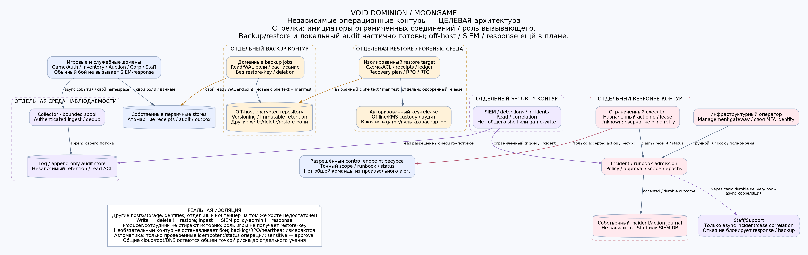
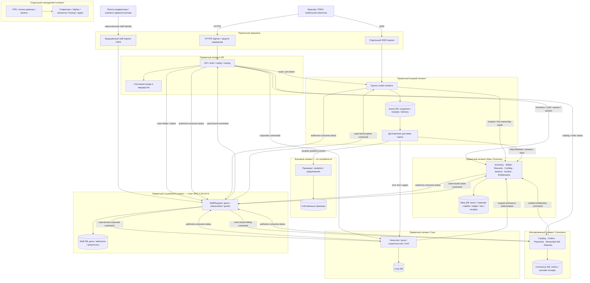

# Карта архитектуры — сервисы и сетевые сегменты

[Роадмап и задачи MSVC](service-resilience-roadmap.md) ·
[операционные/security-контуры](security-operations-roadmap.md).

> **Канон после решения 2026-10-15 — текст и Mermaid на этой странице.**
> Существующие `diagrams/service-boundaries.{png,pdf,svg,dot}` отражают прежний
> вариант с физически отдельным Auction и оставлены только как исторический снимок.
> В этом изменении графические файлы намеренно не регенерируются.

Карта состоит из игрового/служебного контура ниже и отдельной карты
backup/logs/SIEM/response.

## Что есть сейчас

Game объединяет API/Auth/Lobby, матчи и локальный транзакционный Meta/Economy:
Inventory/Wallet/Rewards/Crafting/Season/Auction/Entitlements с общей игровой БД.
Commerce v0 имеет отдельный процесс и PostgreSQL, но реальные провайдеры отключены;
[объём реализации и запуск](meta-economy.md). Corp поддерживает отдельный процесс и отдельную PostgreSQL;
его перенос и состояние живого сервера не подтверждены этой картой.
Исходящие обращения к Corp ограничены `DependencyGuard`.
Минимальный отдельный `/admin` (roster/kick) существует; полноценные модераторский
пульт и [Staff/Support с заявками и grants](staff-case-roadmap.md) ещё в плане.

Ниже **целевая** топология после решения 2026-10-15. Commerce физически отделён,
а Inventory/Wallet/Rewards/Crafting/Season/Auction объединены в один Meta/Economy
transaction boundary. Каждый блок сегмента означает отдельную политику доступа,
а не уже развёрнутый VLAN/контейнер/хост. Приватная сеть допускает только заданные
соединения; сетевое разрешение всегда дополняется проверкой identity и операции.
Общий физический хост, PG-кластер, DNS, edge или secret-store могут оставаться общей
точкой отказа: сегментация сама по себе не доказывает HA/DR.

[Операционная карта PNG](diagrams/security-operations.png) ·
[PDF](diagrams/security-operations.pdf) · [SVG](diagrams/security-operations.svg) ·
[Исходник DOT](diagrams/security-operations.dot).

## Схема прямо на странице

Для компактности stores нарисованы внутри доменных блоков. В реализации у каждого
store отдельный data-сегмент/ACL: подключается только владелец и конкретные временные
административные jobs. API/Auth/Lobby пока роль Game; его состояние, интерфейс
матч-браузера и перенос прорабатываются с SV-4.1/OPS-2.1. Это не объявление нового
самостоятельного Auth-микросервиса. Сборщик долговечных событий также остаётся ролью
владельца Game до появления причины отделить его.
Staff и management разделены: сотрудник игры не получает инфраструктурные credentials.
Обратные owner → Staff вызовы нужны только для принятия служебного действия;
обычные команды игроков/бой не зависят от Staff. API/Auth как owner accounts использует
тот же ограниченный consume/status внутри своей разрешённой связи со Staff.
Двойные стрелки Staff в DOT/PNG означают две разрешённые инициации: служебная команда
к owner и owner → Staff consume/status. Это не изображение HTTP-ответа как нового вызова.

## Целевая матрица разрешений

Это исходная матрица для MSVC-7. Точные endpoints, порты и механизм сетевого
enforcement фиксируются перед включением конкретного домена. Направление стрелки —
инициатор соединения; ответ в этом соединении не разрешает новую обратную связь.

| Источник | Назначение | Разрешённое назначение соединения |
| --- | --- | --- |
| Браузер | HTTPS ingress | Публичные игровые API по HTTPS; внутренние `/internal/*` не маршрутизируются |
| Браузер | Отдельный WSS ingress | Соединение с назначенным worker по join-token |
| HTTPS ingress | API/Auth/Lobby | Только опубликованные HTTP-маршруты; origin защищён от обхода ingress |
| WSS ingress | Назначенные workers | Только WS upgrade; независим от процесса API/Auth |
| Сотрудник / служебный пульт | Защищённый staff ingress | Персональная staff identity/MFA; роль и case-scope проверяются сервером |
| Staff ingress | Staff/Support | Только публичные staff-маршруты; внутренний consume/status не опубликован |
| API/Auth/Lobby | Workers / их маршрутизатор | Управление местом и маршрутом; scoped операции, без горячего пути боя |
| API/Auth/Lobby | Meta/Economy | Личный арсенал, крафт, сезон, Auction и другие команды с правами исходного actor |
| API/Auth/Lobby | Commerce | Каталог, создание/статус заказа; клиент не передаёт доверенный статус платежа |
| API/Auth/Lobby | Corp | Корпоративные команды с проверкой членства/ролей |
| API/Auth/Lobby | Staff/Support | Игровой intake/статус только своего дела; отдельный owner-identity вызов consume/status для accounts-команд |
| Staff/Support | Game / Auth/accounts / Meta/Economy / Commerce / Corp | Только предусмотренные case-bound служебные команды; исходный employee, audience, target, actionId и policy-лимиты |
| Game / Auth/accounts / Meta/Economy / Commerce / Corp | Staff/Support | Авторизованный owner принимает/проверяет grant через атомарный consume/status; только служебный путь |
| Доменная роль долговечной доставки | Staff/Support | Отдельный аутентифицированный intake системного источника; eventId, bounded retries и дедупликация, вне горячего пути боя |
| Commerce | Meta/Economy | Только versioned/idempotent entitlement/refund-команды по стабильному order/provider transaction ID; без SQL-доступа к Meta DB |
| Corp | Meta/Economy | Только scoped rent/return authorization для конкретного предмета/получателя/матча |
| Game/workers и роль доставки Game | Meta/Economy | Loadout/live ownership reads; идемпотентная выдача/износ/награды после результата |
| Game/workers и роль доставки Game | Corp | Ограниченные AvA RPC, доставка результата и аудита |
| Владелец Game / его роль доставки | Фоновые потребители | Версионированные durable события, без права выдать валюту от имени проекции |
| Каждый доменный runtime | Только собственный store | Собственная DML-роль, TLS и отдельный data ACL; никаких чужих таблиц/DDL |
| Оператор | Management access gateway | Отдельная сильная аутентификация, ограниченный срок, журнал и отзыв |
| Management gateway — bastion/access proxy | Разрешённая management job / управляемый endpoint хоста | Инициирует только согласованный SSH/control-сеанс к конкретному ресурсу; identity gateway и исходный operator связаны в аудите, credentials job отдельны |
| Авторизованная management job | Конкретный хост/store | Deploy, миграция, backup либо restore своим набором прав; не постоянный доступ приложения |
| Runtime / job | DNS / secret-store / аудит | Только явно нужные адреса и операции; свой namespace секретов и write-only аудит |
| Backup job | Зашифрованное хранилище бэкапов | Отдельная роль своего домена; offline ключ восстановления вне runtime |
| Доменный producer | Collector/audit ingest | Authenticated append своего потока через bounded async spool; доступа в log admin нет |
| Collector | Log/audit store | Append/dedup своего namespace; producer/сотрудник не меняют историю/retention |
| SIEM | Разрешённые security-потоки log/audit store | Read/correlation; без игровых write и backup deletion/management credentials |
| SIEM | Incident/runbook admission | Ограниченный trigger/incident, не произвольная команда или shell |
| Инфраструктурный оператор через management | Incident/runbook admission | Персональные полномочия и approval; путь независим от Staff/SIEM |
| Response executor | Предусмотренный target control endpoint | Scope/job/resource/actionId по policy; status/receipt, unknown без небезопасного retry |
| Response executor | Incident/runbook admission | Claim только назначенного actionId, lease/status/receipt; собственная workload identity, без изменения policy |
| Backup job | Свой domain store/WAL endpoint | Read/replication область; отдельная роль, не общий DB-admin |
| Restore lab | Repository / контролируемый key-release | Read выбранного ciphertext/manifest, отдельная авторизация ключа; runtime/пульты доступа не имеют |
| Incident delivery role | Staff/Support system intake | Асинхронная корреляция incident/case; отказ Staff не блокирует infra-response |

Связи для исходящих уведомлений/IdP/edge-провайдера добавляются адресно при их
внедрении. Общий доступ в интернет не выдаётся ради удобства. Серверный браузерный
трафик и управленческие соединения имеют разные политики; диагностическое открытие
всех соединений не является этапом миграции.
Доступ runtime к клиентскому endpoint secret-store/аудита не включает их
административные API; эти поверхности и credentials разделяются.
Служебный доступ не разрешает Staff читать чужие БД или обращаться к management.
Межсервисный тикет не расширяет whitelist бизнес-команд владельца домена; права,
точка принятия/отзыва и неизвестный исход определены в [контракте Staff](staff-case-roadmap.md).
При VPN доступ operator → gateway → ресурс маршрутизируется с сохранением
идентичности VPN-peer и её ACL. Если используется SNAT/proxy, общий исходный IP
не подтверждает личность: конечный ресурс проверяет credentials оператора/job,
а аудит связывает peer/operator, gateway и целевую операцию. VPN и bastion —
варианты реализации одного ограниченного канала; ни один не выдаёт blanket-доступ.

**По умолчанию запрещено:** браузер → внутренние API/БД; Commerce → Game/Corp DB
или Meta DB напрямую; Meta/Economy → payment-provider secrets; runtime →
управляющие поверхности management/SSH/Docker socket; соседний runtime → чужие
секреты; произвольный egress. Допустимые бизнес-команды проверяются независимо от ACL:
identity Commerce не разрешает произвольную выдачу предмета/Варрантов, а identity
Meta/Economy не разрешает подделать provider payment. Контракт MSVC-1 связывает
actor, предмет/продукт, цену/валюту, получателя, комиссию и стабильный ID операции;
доверенный transport не заменяет это подтверждение.

## Внутри каждого сервиса

Доменные правила не импортируют HTTP, SQL или инфраструктуру. Сценарии приложения
организуют actor/authz, транзакцию, receipt и вызов портов. Внешние адаптеры реализуют
эти порты; entrypoint собирает зависимости. Проверки границ импортов — MSVC-6.
Бой остаётся детерминированным модульным ядром, а не сетевым вызовом на каждый шаг.

## Как карта становится проверенной конфигурацией

- **MSVC-6:** проверенные границы бизнес-правил/сценариев/адаптеров.
- **MSVC-7:** исполняемая сетевая политика и позитивные/негативные пробы из каждого сегмента.
- **MSVC-8:** отдельный административный канал, отзыв и аудит доступа.
- **MSVC-9:** имитация захваченного runtime и украденных ограниченных credentials.
- **MSVC-5:** выключения сервисов/БД, потеря ответа после commit и восстановление данных.
- **OPS-4.3/4.4/4.5:** служебные дела, ограниченные полномочия и проверки внутреннего злоупотребления.
- **SE-3.5/8.1/8.4/8.5/9.2:** отдельные backup/log-audit/SIEM/response среды и учение восстановления.

Эти задачи записаны в [роадмапе](service-resilience-roadmap.md), общие механизмы —
в [роадмапе безопасности](secure-environment-roadmap.md). Наличие карты и зелёный
CI документации не подтверждают сетевую политику действующего сервера.
